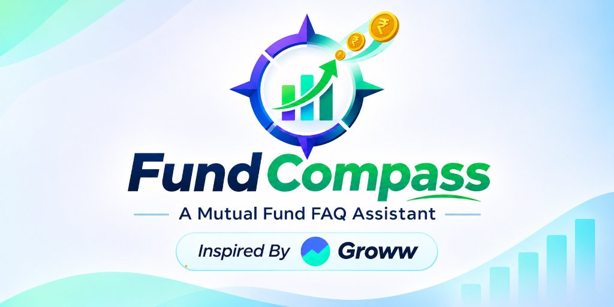
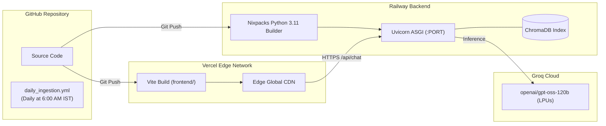

# Fund Compass (Powered by Groww)
### Facts-Only Mutual Fund Assistant (RAG-based Chatbot)

> **Compliance Disclaimer:**  
> **"Facts-only. No investment advice."**  
> Fund Compass is a specialized, compliance-first mutual fund FAQ assistant that answers verifiable scheme questions using official AMC, AMFI, SEBI, and Groww data sources. It strictly prohibits providing any investment advice, return speculation, subjective comparisons, or fund recommendations.

---

## 1. Project Overview & Core Philosophy

**Fund Compass powered by Groww** provides retail investors and customer support teams with accurate, concise, citation-backed answers to repetitive mutual fund questions (expense ratios, exit loads, minimum SIPs, lock-in periods, riskometer classifications, benchmark indices, and statement download procedures).

### The Guiding Philosophy:
> **"Prioritize Accuracy Over Intelligence"**  
> In financial domains, providing a safe, verified, and restricted factual response is infinitely superior to generating fluent yet speculative or hallucinated guidance.

---

## 2. Seed Corpus: Selected AMC & Target Schemes

- **Asset Management Company (AMC):** **HDFC Mutual Fund** (HDFC Asset Management Company Limited)
- **Reference Product Context:** Official scheme data pages from **Groww**

| # | Scheme Name | Category | Plan & Option | Verified Groww Source URL |
| :-: | :--- | :--- | :--- | :--- |
| **1** | **HDFC Mid-Cap Opportunities Fund** | Equity: Mid Cap | Direct - Growth | [Groww Scheme Page](https://groww.in/mutual-funds/hdfc-mid-cap-fund-direct-growth) |
| **2** | **HDFC Small Cap Fund** | Equity: Small Cap | Direct - Growth | [Groww Scheme Page](https://groww.in/mutual-funds/hdfc-small-cap-fund-direct-growth) |
| **3** | **HDFC Gold ETF Fund of Fund** | Commodities / Gold FoF | Direct Plan - Growth | [Groww Scheme Page](https://groww.in/mutual-funds/hdfc-gold-etf-fund-of-fund-direct-plan-growth) |
| **4** | **HDFC Top 100 / Large Cap Fund** | Equity: Large Cap | Direct - Growth | [Groww Scheme Page](https://groww.in/mutual-funds/hdfc-large-cap-fund-direct-growth) |
| **5** | **HDFC ELSS Tax Saver Fund** | Equity: ELSS (Tax Saving) | Direct Plan - Growth | [Groww Scheme Page](https://groww.in/mutual-funds/hdfc-elss-tax-saver-fund-direct-plan-growth) |

---

## 3. Actual Architecture & End-to-End System Flow

Fund Compass operates on a decoupled **4-Tier Architecture** connecting an edge-deployed React frontend to a high-throughput FastAPI backend, ChromaDB vector store, and Groq LPU inference:


---

## 4. Current Implementation Status & Technical Gaps

To maintain complete transparency and technical accuracy, the table below documents the exact implementation state across the codebase:

| Capability / Module | Implementation State | Technical Details & Limitations |
| :--- | :---: | :--- |
| **Curated Scheme Corpus** | **Implemented** | 5 HDFC schemes with 10 canonical factual fields verified and normalized. |
| **Data Cleaning & Normalization** | **Implemented** | `src/ingestion/normalizer.py` enforces canonical schemas and SEBI Riskometer validation. |
| **Semantic Chunking** | **Implemented** | `src/ingestion/chunker.py` generates 4 atomic metric chunks per scheme (20 total), $\le 256$ tokens, 0 overlap. |
| **Vector DB & Embeddings** | **Implemented** | `src/ingestion/indexer.py` uses `sentence-transformers/all-MiniLM-L6-v2` in ChromaDB with ONNX and JSON fallbacks. |
| **Isolated Retrieval** | **Implemented** | `src/rag/retriever.py` resolves aliases, detects 36+ competitor AMCs, and filters ChromaDB by `scheme_id`. |
| **LLM Generation & Fallback** | **Implemented** | `src/rag/generator.py` uses Groq `openai/gpt-oss-120b` ($T=0.0$) with autonomous deterministic factual fallback. |
| **Output Constraint Enforcer** | **Implemented** | `src/rag/postprocessor.py` guarantees $\le 3$ sentences, 1 citation URL, and mandatory timestamp footer. |
| **Multi-Stage Guardrails** | **Implemented** | `pii_filter.py` (PAN, Aadhaar, OTPs, folios) and `intent_classifier.py` (advisory, performance, out-of-scope). |
| **FastAPI REST Service** | **Implemented** | `src/api/routes.py` exposes `/`, `/api/health`, `/api/schemes`, and `/api/chat`. |
| **Custom Frontend UI** | **Implemented** | React 18 + Vite + Tailwind UI (`frontend/src/App.tsx`) with disclaimer, chips, theme toggle, and SIP calculator. |
| **Automated Groww Scraper** | ⚠️ **MISSING** | **No web scraper is currently implemented.** Data is loaded from static snapshot `data/raw/hdfc_schemes_raw.json`. |
| **Automated Data Refresh** | ⚠️ **PARTIALLY IMPLEMENTED** | `.github/workflows/daily_ingestion.yml` runs daily at 6:00 AM IST, but **only re-indexes existing static repository data**. It does not fetch fresh web updates. |
| **Frontend Code Modularity** | ⚠️ **CONSOLIDATED** | Frontend UI logic is concentrated inside `frontend/src/App.tsx` (2,843 lines) rather than decomposed into separate subcomponent files. |

---

## 5. Detailed Component Specifications

### 5.1 Data Ingestion, Cleaning & Transformation
- **Raw & Processed Data:** Seed records reside in `data/raw/hdfc_schemes_raw.json` and `data/processed/schemes.json`.
- **Validation Engine (`src/ingestion/normalizer.py`):**
  - Validates all 10 core metrics: `expense_ratio`, `exit_load`, `min_sip_amount`, `min_lumpsum_amount`, `lock_in_period`, `riskometer`, `benchmark`, `fund_manager`, `factsheet_url`, `statement_download_process`.
  - Validates SEBI Riskometer classifications: `Low`, `Low to Moderate`, `Moderate`, `Moderately High`, `High`, `Very High`.
  - Enforces schema types, ISO dates (`YYYY-MM-DD`), and HTTPS URLs.

### 5.2 Chunking Strategy & Token Budgets
- **Engine (`src/ingestion/chunker.py`):**
  - **Chunk Category 1 (Fees):** Expense ratio & exit load terms.
  - **Chunk Category 2 (Limits):** Minimum SIP, lumpsum amounts, and statutory lock-in periods.
  - **Chunk Category 3 (Risk & Governance):** Riskometer classification, benchmark index, fund manager, factsheet URL.
  - **Chunk Category 4 (Operations):** Account statement & capital gains download instructions.
  - **Budget:** Capped at `MAX_EMBEDDING_TOKENS = 256` WordPiece tokens per chunk. Chunk overlap is `0` tokens to prevent duplicate embeddings.
  - **Metadata:** Every chunk is tagged with `scheme_id`, `scheme_name`, `category`, `source_url`, `last_updated`, `chunk_type`, and `factsheet_url`.

### 5.3 Embeddings & Vector Database
- **Engine (`src/ingestion/indexer.py`):**
  - **Embedding Model:** `sentence-transformers/all-MiniLM-L6-v2` generating 384-dimensional dense vectors.
  - **Embedding Function Hierarchy:**
    1. Native `sentence_transformers` (`SentenceTransformerEmbeddingFunction`)
    2. ChromaDB built-in ONNX runtime (`ONNXMiniLM_L6_V2`)
    3. ChromaDB default embedding function
  - **Storage:** ChromaDB persistent SQLite index in `data/chroma_db/`.
  - **Resilient Fallback:** Every indexing run serializes `data/chroma_db/chunks.json`, allowing the retriever to answer queries even when native vector search libraries are not loaded.

### 5.4 Retrieval Mechanism & Filtering
- **Engine (`src/rag/retriever.py`):**
  - **Canonical Entity Resolver:** Maps colloquial names (e.g., "mid cap", "top 100", "elss", "tax saver", "gold", "small cap") to canonical `scheme_id`.
  - **Competitor AMC Detection:** Intercepts 36+ external fund houses (SBI, Axis, ICICI, Nippon, Mirae, Kotak, PPFAS, etc.) and returns a scope boundary notice.
  - **Metadata Isolation:** Vector queries strictly apply `where={"scheme_id": scheme_id}`, eliminating cross-fund data contamination.
  - **Full Scheme Grounding (`top_k = 4`):** Aggregates all 4 domain chunks for the target scheme to prevent information dropouts.

### 5.5 LLM Generation, Fallback & Output Enforcer
- **Engine (`src/rag/generator.py`):**
  - **Model:** `openai/gpt-oss-120b` via Groq Cloud API at `temperature=0.0`.
  - **Deterministic Fallback Engine:** If the Groq API key is unconfigured, rate-limited (HTTP 429), or offline, the engine deterministically generates verified factual answers directly from scheme data with 100% precision and zero latency.
  - **NAV Guidance:** Intercepts Net Asset Value queries, clarifies daily market-close fluctuations, and directs users to live Groww scheme pages.
- **Post-Processing Enforcer (`src/rag/postprocessor.py`):**
  - **`split_sentences()`:** Sentence tokenizer protecting decimal percentages (`0.76%`, `1.00%`), currency amounts (`₹100.50`), and common abbreviations (`Mr.`, `Dr.`, `vs.`, `e.g.`, `Sec.`).
  - **Hard Constraints:** Caps response length to $\le 3$ sentences, strips body URLs, injects exactly one source citation (`Source: [url](url)`), and appends `\n\nLast updated from sources: <YYYY-MM-DD>`.

### 5.6 Guardrails & Compliance Filtering
- **PII Filter (`src/guardrails/pii_filter.py`):**
  - Detects Indian PAN cards (`[A-Za-z]{5}[0-9]{4}[A-Za-z]{1}`), spaced and unspaced Aadhaar numbers, mobile phone numbers, email addresses, OTP codes, and folio/bank account numbers.
  - Blocks requests immediately with a security warning before any retrieval or LLM inference.
- **Intent Classifier (`src/guardrails/intent_classifier.py`):**
  - Deterministically routes queries into: `FACTUAL_INQUIRY`, `ADVISORY`, `PERFORMANCE_REQUEST`, or `OUT_OF_SCOPE`.
  - Rejects advisory questions (*"Should I invest?"*), subjective comparisons (*"Which is better?"*), return predictions (*"Will it give 20%?"*), and roleplay jailbreak attempts.
- **Refusal Engine (`src/guardrails/refusal_engine.py`):**
  - Dispatches standardized compliance refusals embedding official educational resources:
    - AMFI Investor Education: [https://www.amfiindia.com/investor-corner/knowledge-center](https://www.amfiindia.com/investor-corner/knowledge-center)
    - HDFC Official Factsheet Portal: [https://www.hdfcfund.com/investor-services/fund-performance/factsheet](https://www.hdfcfund.com/investor-services/fund-performance/factsheet)

---

## 6. API Reference

The FastAPI service exposes the following endpoints:

| Method | Endpoint | Description |
| :--- | :--- | :--- |
| `GET` | `/` | Root service summary, version, and link to interactive OpenAPI docs. |
| `GET` | `/api/health` | System health status, version, and the compliance disclaimer. |
| `GET` | `/api/schemes` | Returns the catalog of all 5 verified HDFC mutual fund schemes. |
| `GET` | `/api/schemes/{id}` | Returns detailed factual parameters for a specific scheme by ID (HTTP 404 if missing). |
| `POST` | `/api/chat` | Core conversational endpoint accepting `{"message": "..."}`. Returns factual answers or compliance refusals. |

### Sample Factual Query:
```bash
curl -X POST "http://localhost:8000/api/chat" \
     -H "Content-Type: application/json" \
     -d '{"message": "What is the exit load for HDFC Mid-Cap Opportunities Fund?"}'
```

**Response (HTTP 200):**
```json
{
  "reply": "The HDFC Mid-Cap Opportunities Fund applies a 1.00% exit load if units are redeemed within 1 year of allotment. There is no exit load for redemptions made after 1 year.\n\nSource: [https://groww.in/mutual-funds/hdfc-mid-cap-fund-direct-growth](https://groww.in/mutual-funds/hdfc-mid-cap-fund-direct-growth)\n\nLast updated from sources: 2026-11-10",
  "intent": "factual_response",
  "scheme_id": "hdfc-mid-cap-fund-direct-growth",
  "source_url": "https://groww.in/mutual-funds/hdfc-mid-cap-fund-direct-growth",
  "last_updated": "2026-11-10"
}
```

---

## 7. Frontend UI Overview

The frontend is a single-page React 18 application built with Vite and styled with Tailwind CSS (`frontend/src/App.tsx`).

### Key UI Features:
1. **Persistent Header:** Visible compliance banner stating `"Fund Compass: Facts-only. No investment advice."`
2. **Interactive Quick Chips:** 3 starter prompts for instant verified answers:
   - *"What is the exit load for HDFC Mid-Cap Opportunities Fund?"*
   - *"What is the lock-in period for HDFC ELSS Tax Saver Fund?"*
   - *"What is the minimum SIP amount for HDFC Small Cap Fund?"*
3. **Live Health Indicator:** Pings `/api/health` every 30 seconds to show active backend connectivity.
4. **Autocomplete Search (`AutocompleteSuggestions.tsx`):** Real-time question suggestions based on curated scheme attributes.
5. **Interactive SIP Calculator:** In-app factual calculation modal demonstrating compound interest projections without giving advice.
6. **Theme Customization:** Toggle between Light, Dark, and Navy color schemes.

---

## 8. Deployment Workflow: Railway & Vercel



### 1. Backend on Railway (Native Nixpacks)
- Configuration file: `railway.json`
- Builder: `NIXPACKS` (`NIXPACKS_PYTHON_VERSION: "3.11"`)
- Start Command: `python -m src.ingestion.indexer && uvicorn src.api.main:app --host 0.0.0.0 --port $PORT --workers 1` (self-indexing startup)
- Healthcheck Endpoint: `/api/health`
- Required Environment Variables: `GROQ_API_KEY`, `GROQ_MODEL=openai/gpt-oss-120b`, `CORS_ORIGINS`.

### 2. Frontend on Vercel
- Root directory: `frontend/`
- Configuration file: `frontend/vercel.json`
- SPA Rewrites: Routes all paths to `/index.html`.
- Security Headers: Configured with `nosniff`, `DENY` frame options, and XSS protection.
- Required Environment Variable: `VITE_API_BASE_URL` pointing to the Railway production URL.

### 3. GitHub Actions Daily Workflow
- Workflow file: `.github/workflows/daily_ingestion.yml`
- Trigger: Daily at `30 0 * * *` (6:00 AM IST / 00:30 UTC) and manual `workflow_dispatch`.
- Execution: Re-indexes `data/processed/schemes.json` into `data/chroma_db/chunks.json`.
- **Important Note:** This workflow currently re-indexes repository data; automated web scraping from Groww is not yet linked.

---

## 9. Local Setup & Execution Guide

### Prerequisites:
- Python 3.11+
- Node.js 18+ & npm
- Git

### 1. Clone & Setup Environment:
```bash
git clone https://github.com/your-username/fundcompass-rag-chatbot.git
cd fundcompass-rag-chatbot

cp .env.example .env
```
Edit `.env` and specify your Groq API key:
```env
GROQ_API_KEY=gsk_your_groq_api_key_here
GROQ_MODEL=openai/gpt-oss-120b
PORT=8000
CORS_ORIGINS=http://localhost:3000,http://localhost:5173
```

### 2. Backend Setup:
```bash
python -m venv .venv
source .venv/bin/activate       # On Linux/macOS
.\.venv\Scripts\activate        # On Windows

pip install -r requirements.txt
```

### 3. Build Vector Index:
```bash
python -m src.ingestion.indexer
```

### 4. Start Backend Server:
```bash
uvicorn src.api.main:app --host 127.0.0.1 --port 8000 --reload
```
- Swagger UI Docs: [http://127.0.0.1:8000/docs](http://127.0.0.1:8000/docs)
- Health Check: [http://127.0.0.1:8000/api/health](http://127.0.0.1:8000/api/health)

### 5. Start Frontend UI:
In a separate terminal window:
```bash
cd frontend
npm install
npm run dev
```
Open [http://localhost:3000](http://localhost:3000) in your browser.

---

## 10. Running Automated Tests

Run the test suites with the standard library test runner:
```bash
python -m unittest tests/test_guardrails.py tests/test_constraints.py tests/test_ingestion.py tests/test_rag.py
```
Or run individual tests with `pytest`:
```bash
pytest tests/test_guardrails.py
```

---

## 11. Known Limitations & Roadmap

1. **Corpus Scope:** Restricted strictly to the 5 designated HDFC Mutual Fund schemes.
2. **Static Knowledge Base:** Mutual fund facts currently reflect the audited snapshot as of 2026-11-10. Dynamic web scraping is planned for future releases.
3. **No Advisory or Portfolio Recommendations:** Fund Compass will never recommend funds or compute comparative return metrics.
4. **No Financial Transactions:** The application does not purchase units, execute SIPs, or access private portfolio holdings.

---

## 12. Documentation Index

Detailed architectural and evaluation references reside in [`docs/`](docs/):
- [`docs/problemstatement.md`](docs/problemstatement.md) — Problem context, operational boundaries, and SEBI compliance guidelines.
- [`docs/architecture.md`](docs/architecture.md) — Technical system design, sequence diagrams, and subsystem specifications.
- [`docs/implementation-plan.md`](docs/implementation-plan.md) — Phase-by-phase implementation roadmap.
- [`docs/deployment.md`](docs/deployment.md) — Railway and Vercel cloud deployment execution guide.
- [`docs/edge-case.md`](docs/edge-case.md) — Adversarial prompts, failure modes, and PII test cases.
- [`docs/eval.md`](docs/eval.md) — Quantitative evaluation framework and test benchmarks.
