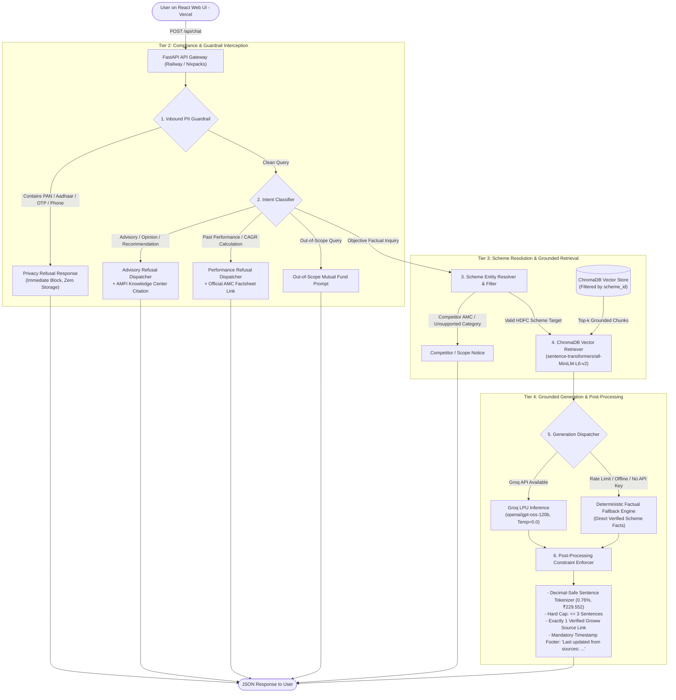
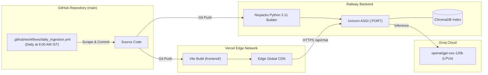

# Fund Compass (Powered by Groww)
### Facts-Only Mutual Fund Assistant (RAG-based Chatbot)

> **Compliance Disclaimer:**  
> **"Facts-only. No investment advice."**  
> Fund Compass is a compliance-first mutual fund FAQ assistant that answers verifiable scheme questions using official AMC, AMFI, SEBI, and Groww data sources. It strictly prohibits providing investment advice, return speculation, subjective comparisons, or fund recommendations.

---

## 1. Project Overview & Core Philosophy

**Fund Compass powered by Groww** provides retail investors and customer support teams with accurate, concise, citation-backed answers to repetitive mutual fund questions (expense ratios, exit loads, minimum SIPs, lock-in periods, verified Net Asset Values, riskometer classifications, benchmark indices, and statement download procedures).

### The Guiding Philosophy:
> **"Prioritize Accuracy Over Intelligence"**  
> In financial domains, providing a safe, verified, and restricted factual response is infinitely superior to generating fluent yet speculative or hallucinated guidance.

---

## 2. Seed Corpus: Selected AMC & Target Schemes

- **Asset Management Company (AMC):** **HDFC Mutual Fund** (HDFC Asset Management Company Limited)
- **Reference Product Context:** Official scheme data pages from **Groww**
- **Effective Valuation Date:** **2026-11-10**

| # | Scheme Name | Category | Plan & Option | Verified NAV | Groww Source URL |
| :-: | :--- | :--- | :--- | :---: | :--- |
| **1** | **HDFC Mid-Cap Opportunities Fund** | Equity: Mid Cap | Direct - Growth | **₹229.552** | [Groww Mid-Cap Factsheet](https://groww.in/mutual-funds/hdfc-mid-cap-fund-direct-growth) |
| **2** | **HDFC Small Cap Fund** | Equity: Small Cap | Direct - Growth | **₹155.255** | [Groww Small Cap Factsheet](https://groww.in/mutual-funds/hdfc-small-cap-fund-direct-growth) |
| **3** | **HDFC Gold ETF Fund of Fund** | Commodities: Gold FoF | Direct Plan - Growth | **₹43.4947** | [Groww Gold FoF Factsheet](https://groww.in/mutual-funds/hdfc-gold-etf-fund-of-fund-direct-plan-growth) |
| **4** | **HDFC Top 100 / Large Cap Fund** | Equity: Large Cap | Direct - Growth | **₹1269.861** | [Groww Top 100 Factsheet](https://groww.in/mutual-funds/hdfc-large-cap-fund-direct-growth) |
| **5** | **HDFC ELSS Tax Saver Fund** | Equity: ELSS (Tax Saving) | Direct Plan - Growth | **₹1552.433** | [Groww ELSS Factsheet](https://groww.in/mutual-funds/hdfc-elss-tax-saver-fund-direct-plan-growth) |

---

## 3. End-to-End System Architecture

Fund Compass operates on a decoupled **4-Tier Architecture** connecting an edge-deployed React 18 SPA to a high-throughput FastAPI backend, ChromaDB vector store, and Groq LPU inference:



---

## 4. Current Implementation Status

All 5 core engineering priorities are **fully implemented and verified** across the codebase:

| Capability / Module | Implementation State | Technical Details & Verification |
| :--- | :---: | :--- |
| **Curated Scheme Corpus** | **Implemented** | 5 HDFC schemes with 12 canonical factual parameters verified and normalized. |
| **Data Cleaning & Normalization** | **Implemented** | `src/ingestion/normalizer.py` enforces canonical schemas and SEBI Riskometer validation. |
| **Automated Groww Scraper** | **Implemented** | `src/ingestion/scraper.py` fetches live scheme data, validates schemas, and safely updates cache. |
| **Automated Data Refresh** | **Implemented** | `.github/workflows/daily_ingestion.yml` runs daily at 6:00 AM IST (scrape -> index -> artifact -> commit). |
| **Granular Semantic Chunking** | **Implemented** | `src/ingestion/chunker.py` generates 4 atomic metric chunks per scheme (20 total), $\le 256$ tokens, 0 overlap. |
| **Vector DB & Embeddings** | **Implemented** | `src/ingestion/indexer.py` uses `sentence-transformers/all-MiniLM-L6-v2` with ONNX and JSON fallbacks. |
| **Isolated Retrieval** | **Implemented** | `src/rag/retriever.py` resolves colloquial aliases, blocks 36+ competitor AMCs, and filters ChromaDB by `scheme_id`. |
| **Dynamic NAV Retrieval** | **Implemented** | Exact verified NAV retrieval across all 5 schemes with date provenance (`2026-11-10`) and market-close fluctuation notices. |
| **LLM Generation & Fallback** | **Implemented** | `src/rag/generator.py` uses Groq `openai/gpt-oss-120b` ($T=0.0$) with zero-downtime deterministic fallback. |
| **Output Constraint Enforcer** | **Implemented** | `src/rag/postprocessor.py` guarantees $\le 3$ sentences, 1 citation URL, decimal protection, and timestamp footer. |
| **Multi-Stage Guardrails** | **Implemented** | `pii_filter.py` (PAN, Aadhaar, OTPs, folios) and `intent_classifier.py` (advisory, performance, out-of-scope). |
| **FastAPI REST Service** | **Implemented** | `src/api/routes.py` exposes `/`, `/api/health`, `/api/schemes`, and `/api/chat`. |
| **Modular Frontend Architecture** | **Implemented** | React 18 + Vite + Tailwind UI decomposed into clean subcomponents (505-line `App.tsx`) with strict TypeScript (`tsconfig.json`). |
| **Automated Regression Suite** | **Implemented** | **185 tests passing (100%)** across 8 test suites. |

---

## 5. Detailed Component Specifications

### 5.1 Data Ingestion, Scraping & Normalization (`src/ingestion/`)
- **Live Scraper (`src/ingestion/scraper.py`):**
  - Fetches scheme data directly from official Groww URLs with automated retry loops and rate-limiting (`0.5s` delay).
  - Extracts 12 financial attributes using structural parsers and regex patterns.
  - **Fail-Safe Design:** Network errors, HTTP 500s, or rate limits **never overwrite or corrupt previously verified records**.
- **Validation Engine (`src/ingestion/normalizer.py`):**
  - Validates core metrics: `expense_ratio`, `exit_load`, `min_sip_amount`, `min_lumpsum_amount`, `lock_in_period`, `riskometer`, `benchmark`, `fund_manager`, `factsheet_url`, `statement_download_process`, `nav`, `nav_date`.
  - Enforces SEBI Riskometer enumerations: `Low`, `Low to Moderate`, `Moderate`, `Moderately High`, `High`, `Very High`.

### 5.2 Chunking Strategy & Token Budgets (`src/ingestion/chunker.py`)
Rather than arbitrary character splitting, each scheme is decomposed into **4 atomic semantic chunks** (20 chunks total):
1. **Chunk 1 (Costs & Fees):** Direct plan expense ratio, exit load redemption terms, and latest verified NAV with date provenance.
2. **Chunk 2 (Investment Limits):** Minimum monthly SIP amount, minimum lumpsum purchase, and statutory lock-in periods.
3. **Chunk 3 (Risk & Governance):** SEBI Riskometer level, benchmark index (TRI), primary fund manager(s), and official AMC factsheet URL.
4. **Chunk 4 (Operations):** Account statement and capital gains report download procedures (MFCentral/CAMS/HDFC portal).
- **Constraints:** Capped at `MAX_EMBEDDING_TOKENS = 256` WordPiece tokens per chunk. Chunk overlap is `0` tokens to prevent duplicate embeddings.

### 5.3 Embeddings & ChromaDB Vector Store (`src/ingestion/indexer.py`)
- **Embedding Model:** `sentence-transformers/all-MiniLM-L6-v2` generating 384-dimensional dense vectors (~15ms on CPU).
- **Fallback Hierarchy:** PyTorch `SentenceTransformer` -> ChromaDB ONNX runtime -> Default ChromaDB -> Serialized `chunks.json`.
- **Storage:** Persistent SQLite vector store in `data/chroma_db/`.

### 5.4 Retrieval Mechanism & Exact NAV Grounding (`src/rag/retriever.py`)
- **Entity Resolution:** Maps colloquial user queries (e.g., *"mid cap"*, *"tax saver"*, *"gold"*, *"top 100"*) to canonical `scheme_id`.
- **Competitor AMC Detection:** Intercepts 36+ external fund houses (SBI, Axis, ICICI, Nippon, Mirae, Kotak, PPFAS, etc.) and returns a scope boundary notice.
- **Isolated Vector Retrieval:** Queries ChromaDB with `where={"scheme_id": resolved_id}`, guaranteeing zero cross-fund data contamination.
- **Dynamic NAV Grounding:** Returns the latest verified NAV (`₹229.552`, `₹155.255`, `₹43.4947`, `₹1269.861`, `₹1552.433` as of `2026-11-10`), explains that NAV fluctuates daily after market close, and provides the verified Groww factsheet link.

### 5.5 LLM Generation, Fallback & Output Enforcer (`src/rag/generator.py` & `src/rag/postprocessor.py`)
- **Model:** `openai/gpt-oss-120b` via Groq Cloud API at `temperature=0.0`.
- **Zero-Downtime Deterministic Fallback:** If the Groq API key is unconfigured, rate-limited (HTTP 429), or offline, the engine deterministically synthesizes compliant answers directly from verified scheme facts.
- **Sentence Tokenizer (`split_sentences`):** Regex-based splitter that protects decimals (`0.76%`, `1.00%`), currency amounts (`₹229.552`), and abbreviations (`Mr.`, `Dr.`, `vs.`, `e.g.`).
- **Hard Constraints:** Strictly enforces $\le 3$ sentences, strips body URLs, injects exactly one Groww citation (`Source: [url](url)`), and appends `\n\nLast updated from sources: <YYYY-MM-DD>`.

### 5.6 Multi-Stage Guardrails (`src/guardrails/`)
- **PII Filter (`pii_filter.py`):** Intercepts Indian PAN cards (`[A-Za-z]{5}[0-9]{4}[A-Za-z]{1}`), 12-digit Aadhaar numbers, 10-digit mobile numbers, OTPs, and folio IDs before retrieval.
- **Intent Classifier (`intent_classifier.py`):** Deflects advisory questions (*"Should I invest?"*), subjective comparisons (*"Which is better?"*), and return predictions (*"Will it give 20%?"*) to AMFI educational resources.

---

## 6. Frontend Architecture & TypeScript Strictness

The frontend is a modular React 18 SPA built with Vite, Tailwind CSS, and strict TypeScript compiler settings:

### Modular Structure:
* **Master Orchestrator:** `frontend/src/App.tsx` (505 lines of clean state management).
* **View Components:**
  * `Header.tsx`: Branding, mobile drawer trigger, theme selector, API connection badge.
  * `Sidebar.tsx`: Collapsible desktop sidebar, recent queries dropdown popout, investor session badge.
  * `WelcomeHero.tsx`: Central emblem, typography, 4 starter prompt cards, search input with autocomplete.
  * `ChatMessages.tsx`: Message stream with intent badges, copy response button, verified factsheet cards, and provenance timestamps.
  * `ChatDock.tsx`: Floating bottom input bar with quick prompt chips and autocomplete.
* **Modals:**
  * `SupportedSchemesModal.tsx`: Catalog of 5 HDFC schemes with direct fact comparisons.
  * `ComplianceModal.tsx`: Regulatory disclaimers and SEBI non-advisory rules.
  * `EngineModal.tsx`: RAG pipeline architecture and live API status.
  * `SipCalculatorModal.tsx`: Interactive compound interest wealth projection calculator (SIP & Lumpsum).
  * `QuickHelpModal.tsx`: Filterable FAQ accordion organized by scheme tabs.
* **TypeScript Strictness (`frontend/tsconfig.json`):**
  * Configured with `strict: true`, `noImplicitAny: true`, `noUnusedLocals: true`, and zero loose `any` types.

---

## 7. API Reference

| Method | Endpoint | Description |
| :--- | :--- | :--- |
| `GET` | `/` | Root service summary, version, and link to interactive OpenAPI docs. |
| `GET` | `/api/health` | System health status, ChromaDB chunk count, and compliance disclaimer. |
| `GET` | `/api/schemes` | Returns the catalog of all 5 verified HDFC mutual fund schemes. |
| `GET` | `/api/schemes/{id}` | Returns detailed factual parameters for a specific scheme by ID. |
| `POST` | `/api/chat` | Core conversational endpoint accepting `{"message": "..."}`. Returns factual answers or compliance refusals. |

### Sample Factual Query:
```bash
curl -X POST "http://localhost:8000/api/chat" \
     -H "Content-Type: application/json" \
     -d '{"message": "What is the NAV of HDFC Mid-Cap Opportunities Fund?"}'
```

**Response (HTTP 200):**
```json
{
  "reply": "The Net Asset Value (NAV) of HDFC Mid-Cap Opportunities Fund (Direct Plan - Growth) is ₹229.552 as of 2026-11-10. Net Asset Value fluctuates daily based on market movements and is declared after market close each business day.\n\nSource: [https://groww.in/mutual-funds/hdfc-mid-cap-fund-direct-growth](https://groww.in/mutual-funds/hdfc-mid-cap-fund-direct-growth)\n\nLast updated from sources: 2026-11-10",
  "intent": "factual_response",
  "source_url": "https://groww.in/mutual-funds/hdfc-mid-cap-fund-direct-growth",
  "last_updated": "2026-11-10"
}
```

---

## 8. Deployment Architecture: Railway, Vercel & GitHub Actions



* **Backend on Railway**: Containerless Nixpacks Python 3.11 runtime (`railway.json`), self-indexing on startup (`python -m src.ingestion.indexer`), probed via `/api/health`.
* **Frontend on Vercel**: High-speed edge CDN distribution (`frontend/vercel.json`), client-side SPA rewrites, and security headers.
* **Daily Ingestion on GitHub Actions**: Runs scraper -> normalizer -> indexer daily at 6:00 AM IST, committing verified updates back to `main`.

---

## 9. Local Setup & Execution Guide

### Prerequisites:
- Python 3.11+
- Node.js 18+ & npm
- Git

### 1. Clone & Configure Environment:
```bash
git clone https://github.com/beyoujagat/fundcompass-rag-chatbot.git
cd fundcompass-rag-chatbot

cp .env.example .env
```
Edit `.env` (Groq API key is optional; system runs on deterministic fallback if omitted):
```env
GROQ_API_KEY=gsk_your_groq_api_key_here
GROQ_MODEL=openai/gpt-oss-120b
PORT=8000
CORS_ORIGINS=http://localhost:3000,http://localhost:5173
```

### 2. Backend Setup:
```bash
python -m venv .venv
source .venv/bin/activate       # On Linux/macOS
.\.venv\Scripts\activate        # On Windows

pip install -r requirements.txt
```

### 3. Build Vector Index:
```bash
python -m src.ingestion.indexer
```

### 4. Start Backend Server:
```bash
uvicorn src.api.main:app --host 127.0.0.1 --port 8000 --reload
```
- Swagger UI Docs: [http://127.0.0.1:8000/docs](http://127.0.0.1:8000/docs)
- Health Check: [http://127.0.0.1:8000/api/health](http://127.0.0.1:8000/api/health)

### 5. Start Frontend UI:
In a separate terminal:
```bash
cd frontend
npm install
npm run dev
```
Open [http://localhost:3000](http://localhost:3000) in your browser.

---

## 10. Automated Test Suite (185 Tests)

Execute the full regression suite across all 8 modules:
```bash
python -m unittest discover -s tests -p "test_*.py"
```

```text
Ran 185 tests in 17.0s
OK
```

### Test Coverage Breakdown:
1. `tests/test_api.py` (12 tests): Routes, CORS, request validation, error payloads.
2. `tests/test_constraints.py` (8 tests): Decimal protection, 3-sentence ceiling, single citation, timestamp footers.
3. `tests/test_edge_cases.py` (46 tests): 20 adversarial benchmarks with CI/CD skip guards, subtle advisory evasions, PII obfuscation.
4. `tests/test_guardrails.py` (21 tests): Regex PII detection (PAN, Aadhaar, phone, OTP, folio) and intent classification.
5. `tests/test_ingestion.py` (22 tests): Pydantic schema validation, SEBI Riskometer validation, 4-chunk semantic schema.
6. `tests/test_rag.py` (39 tests): Retrieval, competitor AMC blocking, NAV accuracy across all 5 schemes, deterministic fallback.
7. `tests/test_scraper.py` (23 tests): Groww live scraper parsing, fail-safe cache retention, network error resilience.
8. `tests/test_smoke.py` (7 tests): Post-deployment smoke suite.

---

## 11. Known Limitations & Operational Boundaries

1. **Corpus Scope:** Restricted strictly to the 5 designated HDFC Mutual Fund schemes.
2. **Execution-Only / Facts-Only:** Fund Compass will never recommend funds, compute comparative return metrics, or provide advisory services.
3. **No Financial Transactions:** The application does not purchase units, execute SIPs, or access private portfolio holdings.
4. **Daily NAV Cadence:** NAV values reflect official market-close figures (updated daily after 11:00 PM IST per AMFI guidelines).

---

## 12. Documentation Index

Detailed technical specifications reside in [`docs/`](docs/):
- [`docs/architecture.md`](docs/architecture.md) — System architecture, 4-tier design, RAG pipeline deep dive, and subsystem specifications.
- [`docs/deployment.md`](docs/deployment.md) — Railway, Vercel, and GitHub Actions cloud deployment manual.
- [`docs/eval.md`](docs/eval.md) — Quantitative evaluation framework and test benchmarks.
- [`docs/edge-case.md`](docs/edge-case.md) — Adversarial prompts, failure modes, and PII test cases.
- [`docs/problemstatement.md`](docs/problemstatement.md) — Problem statement, operational boundaries, and SEBI compliance guidelines.
