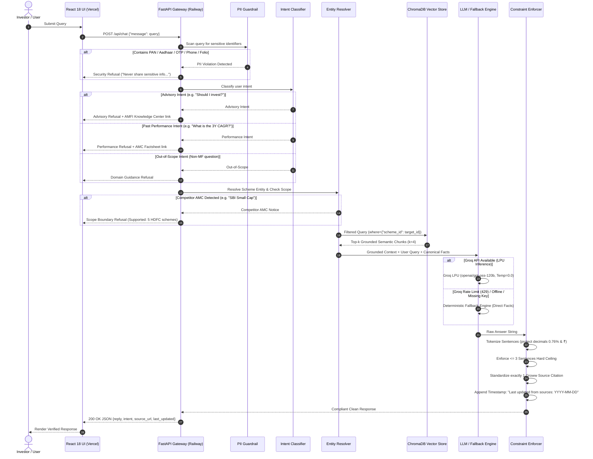
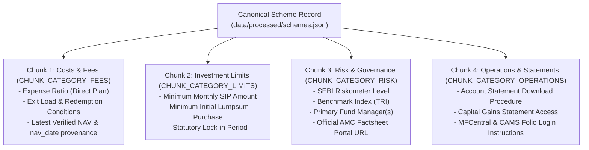

# System Architecture & Technical Design Document
## Fund Compass (Powered by Groww) — Mutual Fund Facts-Only FAQ Assistant

---

## 1. Document Control & Metadata

| Attribute | Details |
| :--- | :--- |
| **Project Name** | Fund Compass — Mutual Fund FAQ Assistant |
| **Reference Context** | Groww Mutual Fund Direct Schemes (HDFC Mutual Fund Corpus) |
| **Document Version** | 3.1.0 (Unified System Architecture & RAG Pipeline Specification) |
| **Status** | Fully Implemented & Verified |
| **LLM Inference** | `openai/gpt-oss-120b` (via **Groq LPU API**, $T=0.0$) with Autonomous Deterministic Fallback |
| **Vector Store & Embeddings** | **ChromaDB** persistent SQLite store with `sentence-transformers/all-MiniLM-L6-v2` (384-dim) |
| **Backend Runtime** | **FastAPI** (Python 3.11+), deployed on **Railway** via native Nixpacks |
| **Frontend Runtime** | **React 18 + Vite + Tailwind CSS + TypeScript Strict**, deployed on **Vercel** Edge Network |
| **Data Ingestion** | Automated Groww Scraper (`src/ingestion/scraper.py`) + Daily GitHub Actions CRON |
| **Test Matrix** | **185 Automated Unit, Guardrail, RAG & Edge-Case Tests (100% Pass Rate)** |
| **Core Directive** | **"Prioritize Accuracy Over Intelligence"** (Zero Hallucination, Zero Advisory) |

---

## 2. Decoupled 4-Tier System Topology

Fund Compass operates as a decoupled 4-tier architecture engineered for sub-second latency, zero cross-fund data contamination, and strict adherence to SEBI non-advisory regulations:

```
┌────────────────────────────────────────────────────────────────────────┐
│             TIER 1: PRESENTATION LAYER (VERCEL EDGE NETWORK)           │
│   React 18 / Vite SPA with Strict TypeScript (frontend/tsconfig.json) │
│   - Modular Architecture: Header, Sidebar, WelcomeHero, ChatFeed, Dock │
│   - Modals: SupportedSchemes, Compliance, EngineStatus, SIPCalc, Help  │
│   - Autocomplete Engine & Real-Time Keyword Matching                   │
│   - In-app Compound Interest SIP & Lumpsum Wealth Projection Calculator│
│   - Multi-Theme Engine: Light, Dark, Soft Blue (Persistent)           │
└───────────────────────────────────┬────────────────────────────────────┘
                                    │ HTTPS REST (/api/chat, /api/schemes, /api/health)
                                    │ CORS-Configured Origin
┌───────────────────────────────────▼────────────────────────────────────┐
│              TIER 2: API GATEWAY & GUARDRAILS (RAILWAY NIXPACKS)       │
│   FastAPI Service │ Pydantic V2 Schemas │ Uvicorn ASGI Server          │
│   - Inbound PII Guardrail: Regex Interception for PAN, Aadhaar, OTP    │
│   - Multi-Class Intent Classifier: Factual vs Advisory vs Performance │
│   - Immediate Refusal Dispatcher with Official AMFI/SEBI Citations     │
└───────────────────┬─────────────────────────────────┬──────────────────┘
                    │ [Advisory / Performance / PII]  │ [Valid Factual Query]
                    ▼                                 ▼
         ┌─────────────────────┐     ┌───────────────────────────────────┐
         │ Fast Refusal Engine │     │     TIER 3: RAG CORE ENGINE       │
         │ - Regulatory Notice │     │  - Canonical Scheme Entity Resolv │
         │ - AMFI/AMC Citation │     │  - 36+ Competitor AMC Filter      │
         │ - Timestamp Footer  │     │  - ChromaDB Isolated Vector Query │
         │                     │     │  - Exact NAV Extraction Engine    │
         │                     │     │  - Groq LPU Inference (Temp=0.0)  │
         │                     │     │  - Zero-Downtime Deterministic FB │
         └──────────┬──────────┘     └─────────────────┬─────────────────┘
                    │                                  │
                    │                ┌─────────────────▼─────────────────┐
                    │                │   POST-PROCESSING SANITIZER       │
                    │                │  - Boundary-Safe Sentence Tokenizer│
                    │                │  - Hard Cap: <= 3 Sentences       │
                    │                │  - Exactly 1 Verified Groww Link  │
                    │                │  - Timestamp Provenance Injection │
                    └────────────────┼─────────────────┬─────────────────┘
                                     │                 │
                                     ▼                 ▼
                       ┌──────────────────────────────────────────────┐
                       │ 200 OK JSON: reply, intent, source, timestamp│
                       └──────────────────────────────────────────────┘
                                     ▲
                                     │ Pre-Indexed Chunks & Facts
┌────────────────────────────────────┴───────────────────────────────────┐
│              TIER 4: INGESTION & KNOWLEDGE PERSISTENCE                 │
│   - Automated Groww Web Scraper & Normalizer (src/ingestion/scraper.py)│
│   - Canonical 4-Chunk Atomic Metric Chunker (src/ingestion/chunker.py) │
│   - ChromaDB Persistent Vector Index (data/chroma_db)                  │
│   - Daily GitHub Actions Automation Workflow (.github/workflows)       │
└────────────────────────────────────────────────────────────────────────┘
```

---

## 3. End-to-End Pipeline & Execution Flow

### 3.1 Sequence Flow
The diagram below illustrates the exact lifecycle of a user request through guardrails, scheme resolution, vector retrieval, grounded generation, and post-processing:



---

## 4. Subsystem Deep-Dive Specifications

### 4.1 Tier 1: Presentation Layer & Modular Frontend Architecture

The frontend is implemented in **React 18**, bundled with **Vite**, styled with **Tailwind CSS**, and strictly typed via [frontend/tsconfig.json](file:///c:/Users/jagat/AI-Projects/fundcompass-rag-chatbot/frontend/tsconfig.json).

#### Component Decomposition Hierarchy
Previously maintained in a single 2,843-line file, the frontend has been refactored into focused, single-responsibility modules:

```
frontend/src/
├── App.tsx                     # Master state orchestrator (505 lines)
├── types.ts                    # Shared TypeScript interfaces & models
├── vite-env.d.ts               # Vite client & asset declarations
├── components/
│   ├── Header.tsx              # Top bar, branding, theme selector, API status
│   ├── Sidebar.tsx             # Collapsible desktop navigation & mobile drawer
│   ├── WelcomeHero.tsx         # Welcome screen, starter cards, primary input
│   ├── ChatMessages.tsx        # Chat thread, intent badges, citation cards, copy
│   ├── ChatDock.tsx            # Floating bottom input bar & autocomplete
│   ├── AutocompleteSuggestions.tsx # Real-time prompt suggestion dropdown
│   └── modals/
│       ├── SupportedSchemesModal.tsx # Catalog of 5 HDFC schemes & metrics
│       ├── ComplianceModal.tsx       # SEBI non-advisory & facts-only guidelines
│       ├── EngineModal.tsx           # RAG architecture & live system status
│       ├── SipCalculatorModal.tsx    # Compound interest SIP/Lumpsum calculator
│       └── QuickHelpModal.tsx        # Filterable scheme FAQ accordion
├── data/
│   ├── canonicalSchemes.ts     # Metadata & facts for the 5 HDFC schemes
│   ├── quickHelpFaqs.ts        # Categorized scheme FAQ pool & filter tabs
│   ├── starterQuestions.tsx    # Starter prompt cards with custom icons
│   └── questionSuggestions.ts  # Autocomplete query pool
└── utils/
    ├── calculator.ts           # Compound interest math & INR formatting
    └── responseParser.tsx      # Token cleaning, markdown & citation extraction
```

#### Key Presentation Capabilities:
1. **Interactive Compound Interest Calculator (`utils/calculator.ts`)**:
   - Computes SIP future value: $FV = P \times \frac{(1+r)^n - 1}{r} \times (1+r)$
   - Computes Lumpsum future value: $FV = P \times (1+r)^n$
   - Real-time wealth gain, total investment, and maturity projections with Indian currency formatting (`₹25,000`).
2. **Persistent Multi-Theme Engine**:
   - Supports `Light`, `Dark`, and `Soft Blue` palettes.
   - Synchronizes `data-theme` attribute on `document.documentElement` and persists to `localStorage`.
3. **Real-Time Autocomplete Engine**:
   - Debounced search matching against 100+ verified scheme prompt templates.
   - Highlights matching tokens with emerald accents.
   - Full keyboard accessibility (Arrow navigation, Enter selection, Escape dismissal).

---

### 4.2 Tier 2: API Gateway & Inbound Guardrails (`src/api/` & `src/guardrails/`)

FastAPI handles asynchronous request orchestration, input sanitization, and compliance enforcement.

#### API Route Contracts:
* `GET /`: Platform welcome banner, version metadata, and supported scheme catalog.
* `GET /api/health`: Health status endpoint returning API connectivity, vector store chunk count, and model configuration.
* `GET /api/schemes`: Returns canonical metadata and verified metrics for the 5 supported schemes.
* `POST /api/chat`: Primary conversational endpoint accepting `ChatRequest` and returning `ChatResponse`.

```python
class ChatRequest(BaseModel):
    message: str = Field(..., max_length=1000, description="User question")

class ChatResponse(BaseModel):
    reply: str
    intent: str
    source_url: Optional[str] = None
    last_updated: Optional[str] = None
```

#### Multi-Stage Guardrail Interception:
1. **PII Sanitizer (`src/guardrails/pii_filter.py`)**:
   - Scans queries for Indian Permanent Account Numbers (PAN: `[A-Z]{5}[0-9]{4}[A-Z]{1}`), spaced and unspaced 12-digit Aadhaar numbers (`\b\d{4}\s\d{4}\s\d{4}\b`), 10-digit mobile numbers (`(?:\+91[\s-]?)?[6-9]\d{9}`), OTPs, and Folio IDs.
   - Intercepts violations before LLM inference, preventing sensitive personal information from ever touching model logs or vector databases.
2. **Intent Classification Engine (`src/guardrails/intent_classifier.py`)**:
   - Categorizes queries into `FACTUAL_INQUIRY`, `ADVISORY_OR_OPINION`, `PERFORMANCE_REQUEST`, or `OUT_OF_SCOPE`.
   - Dispatches regulatory refusals with educational citations ([AMFI Knowledge Center](https://www.amfiindia.com/investor-corner/knowledge-center) or official AMC factsheet portals).

---

### 4.3 Tier 3: Scheme Entity Resolution & Vector Retrieval (`src/rag/`)

#### Canonical Entity Resolution (`src/rag/retriever.py`):
* Colloquial user terms are mapped to canonical IDs via verified alias dictionaries:
  * *"mid cap"*, *"opportunities"* -> `hdfc-mid-cap-fund-direct-growth`
  * *"small cap"* -> `hdfc-small-cap-fund-direct-growth`
  * *"gold"*, *"gold etf"*, *"fof"* -> `hdfc-gold-etf-fund-of-fund-direct-plan-growth`
  * *"top 100"*, *"large cap"* -> `hdfc-large-cap-fund-direct-growth`
  * *"elss"*, *"tax saver"*, *"80c"* -> `hdfc-elss-tax-saver-fund-direct-plan-growth`
* **Competitor Interception**: Detects 36+ external AMCs (SBI, Axis, ICICI, Nippon, Mirae, Kotak, PPFAS, etc.) and gracefully informs the user that only the 5 HDFC schemes are supported.

#### Isolated Metadata Vector Querying:
* Vector searches in ChromaDB enforce a mandatory metadata filter:
  ```python
  collection.query(
      query_texts=[query],
      n_results=4,
      where={"scheme_id": resolved_scheme_id}
  )
  ```
* **Zero Cross-Fund Contamination**: Vector hits from other funds are strictly excluded at the SQLite query level.
* **Top-k Grounding ($k=4$)**: By retrieving all 4 atomic domain chunks for the target scheme, the LLM receives complete factual context.

---

### 4.4 Tier 4: Ingestion, Chunking & Exact Dynamic NAV Retrieval

#### 1. The 4-Chunk Atomic Semantic Schema (`src/ingestion/chunker.py`):
Traditional RAG implementations use naive character-count chunking (e.g. 500 characters with 50-character overlap). In financial RAG, this creates severe failure modes:
* Numerical figures (e.g. `0.76%`) get split from their explanatory context (`expense ratio`).
* Overlapping chunks produce duplicate vector hits and redundant generation.
* Operations instructions get blended into risk governance metrics.

Fund Compass discards naive chunking in favor of **domain-specific atomic metric grouping**. Each scheme is decomposed into exactly **4 semantic chunks** (20 chunks total for the entire corpus):



* **Token Economics**: Capped at `MAX_EMBEDDING_TOKENS = 256` WordPiece tokens per chunk (average: ~40-60 tokens).
* **Zero Chunk Overlap (`CHUNK_OVERLAP_TOKENS = 0`)**: Because each chunk covers an independent financial dimension, zero overlap eliminates vector redundancy and prevents duplicate hits.

#### 2. Embeddings & Vector Indexer (`src/ingestion/indexer.py`):
* **Embedding Model**: `sentence-transformers/all-MiniLM-L6-v2` generating 384-dimensional dense vectors (~15ms on CPU).
* **Fallback Hierarchy**: PyTorch `SentenceTransformer` -> ChromaDB native ONNX runtime (`ONNXMiniLM_L6_V2`) -> Default ChromaDB -> Serialized `chunks.json`.
* **Storage**: Persistent SQLite vector store in `data/chroma_db/`.

#### 3. Exact Dynamic NAV Retrieval Mechanism (`src/rag/generator.py`):
Unlike static fields like lock-in periods, Net Asset Value fluctuates daily based on market closing prices.
* **Storage**: Verified NAV and NAV dates are stored in `data/processed/schemes.json` and indexed into Chunk 1 (`costs_and_fees`).
* **Provenance & Precision**: Queries for NAV retrieve the latest verified value with exact precision (`₹229.552` for Mid-Cap, `₹155.255` for Small Cap, `₹43.4947` for Gold FoF, `₹1269.861` for Top 100, `₹1552.433` for ELSS as of `2026-11-10`).
* **Regulatory Guidance**: Answers explicitly remind the user that NAV fluctuates daily after business hours (market close) and include the verified Groww factsheet link for live intraday verification.
* **Missing NAV Fallback**: If NAV is unavailable or null, the system cleanly redirects the user to the live factsheet without guessing or fabricating numbers.

#### 4. Automated Groww Scraper (`src/ingestion/scraper.py`):
* Fetches live HTML/JSON from official Groww scheme URLs with automated retry loops and rate-limiting delays (`0.5s`).
* Extracts 12 core financial attributes using structural parsers and validates them via Pydantic schemas.
* **Fail-Safe Design**: Network errors, HTTP 500s, or rate limits **never overwrite or corrupt previously verified records**.

#### 5. Daily GitHub Actions Workflow (`.github/workflows/daily_ingestion.yml`):
* Runs daily at 6:00 AM IST (00:30 UTC).
* Executes scraper -> normalizer -> ChromaDB re-indexer -> artifact upload -> automated Git commit and push.

---

### 4.5 Tier 5: Generation, Fallback & Output Constraint Enforcement

#### Inference Engine & System Prompt (`src/rag/generator.py`):
* **Model**: `openai/gpt-oss-120b` on Groq LPUs at `temperature=0.0`.
* **Zero-Downtime Deterministic Fallback**: If the Groq API key is unconfigured, rate-limited (HTTP 429), or unavailable, the system synthesizes factual answers directly from the canonical scheme dictionary.
* **System Prompt Constraint Matrix**:
  ```text
  You are Fund Compass, a strict facts-only mutual fund assistant for retail investors.
  Your responses must follow these STRICT RULES:
  1. Rely ONLY on the provided context. If an answer cannot be verified from the context, state that clearly.
  2. Tone: Formal, objective, factual. Never use marketing or persuasive language.
  3. Length: Maximum of 3 sentences. Be direct, clear, and objective.
  4. Citations: Include exactly ONE official source link at the end of the text.
  5. Absolute Prohibition: NEVER give investment advice, opinions, rating comparisons, or return predictions.
  6. If the user asks for Net Asset Value (NAV), state the latest verified NAV value with its date provenance if available in context, and explain that NAV fluctuates daily after market close.
  ```

#### Post-Processing Constraint Enforcer (`src/rag/postprocessor.py`):
Every response passes through deterministic sanitization:
1. **Sentence Boundary Tokenizer (`split_sentences`)**: Uses regular expression lookbehinds and lookaheads to protect financial decimals (`0.76%`, `1.00%`), currency amounts (`₹229.552`), and abbreviations (`Mr.`, `Dr.`, `vs.`, `e.g.`):
   ```python
   re.split(r'(?<!\b(?:Mr|Mrs|Ms|Dr|vs|e\.g|i\.e|Jan|Feb|Mar|Apr|Jun|Jul|Aug|Sep|Oct|Nov|Dec|Sec))\b(?<!\d)\.(?!\d)\s+', text)
   ```
2. **Length Ceiling**: Slices `sentences[0:3]` to strictly enforce a 3-sentence maximum.
3. **Single Citation Normalization**: Strips inline body links and appends exactly one official Groww factsheet citation: `Source: [https://groww.in/...](https://groww.in/...)`.
4. **Timestamp Provenance**: Appends mandatory source provenance: `\n\nLast updated from sources: 2026-11-10`.

---

## 5. Engineering Trade-Offs & Architectural Decisions

| Engineering Dimension | Chosen Architecture | Alternative Considered | Rationale & Trade-Off |
| :--- | :--- | :--- | :--- |
| **Chunking Strategy** | 4 Domain Semantic Chunks / Scheme | Fixed character chunking (500 chars, 50 overlap) | Domain chunking eliminates boundary splitting of numbers and prevents duplicate vector hits. |
| **Chunk Overlap** | `0 tokens` | `50 - 100 tokens` | Overlap adds redundancy. With atomic metric grouping, chunks are orthogonal; 0 overlap maximizes vector differentiation. |
| **Vector DB Filtering** | Hard Pre-filter: `where={"scheme_id": ...}` | Global semantic retrieval (k=10) | Hard filtering prevents cross-fund contamination (e.g. returning Small Cap exit load for a Mid Cap question). |
| **Embedding Model** | `all-MiniLM-L6-v2` (384-dim) | `text-embedding-3-large` (1536-dim) | Local CPU embedding executes in 15ms without external API costs or rate-limit failures. |
| **LLM Inference** | Groq LPU (`T=0.0`) + Deterministic Fallback | Multi-turn Agent Loop (ReAct / LangChain) | Agent loops add non-deterministic reasoning steps and high latency. Single-shot grounded RAG with fallback guarantees safety and sub-second responses. |
| **Output Constraints** | Deterministic Regex Post-Processor | Prompt-only instruction ("keep under 3 sentences") | LLMs frequently violate length constraints. The post-processor guarantees compliance regardless of model compliance. |

---

## 6. Directory Structure

```
fundcompass-rag-chatbot/
├── .github/
│   └── workflows/
│       └── daily_ingestion.yml    # Daily 6:00 AM IST ingestion & re-indexing
├── assets/                        # Brand logos and documentation graphics
├── data/
│   ├── raw/
│   │   └── hdfc_schemes_raw.json  # Raw source data snapshot
│   ├── processed/
│   │   └── schemes.json           # Canonical validated scheme parameters with NAV
│   └── chroma_db/                 # Persistent ChromaDB SQLite index & chunks.json
├── docs/
│   ├── architecture.md            # System architecture document (this file)
│   ├── deployment.md              # Railway & Vercel deployment manual
│   ├── eval.md                    # Evaluation benchmarks and audit checklists
│   └── problemstatement.md        # Problem statement & compliance directives
├── frontend/                      # React 18 SPA (Target: Vercel)
│   ├── src/
│   │   ├── App.tsx                # Master state orchestrator (505 lines)
│   │   ├── types.ts               # Shared TypeScript models
│   │   ├── vite-env.d.ts          # Vite client declarations
│   │   ├── components/            # Header, Sidebar, WelcomeHero, Chat, Dock, Modals
│   │   ├── data/                  # Canonical schemes, FAQs, starter prompts
│   │   └── utils/                 # Compound interest math & response parser
│   ├── package.json
│   ├── tsconfig.json              # Strict TypeScript compiler options
│   ├── vite.config.ts
│   └── vercel.json                # Vercel SPA rewrites & security headers
├── src/                           # Backend Application (Target: Railway)
│   ├── config.py                  # Environment config & constants
│   ├── api/                       # FastAPI app, routes, and Pydantic schemas
│   ├── guardrails/                # PII filter, intent classifier, refusal engine
│   ├── ingestion/                 # Scraper, normalizer, chunker, indexer
│   └── rag/                       # Retriever, generator, postprocessor
├── tests/                         # 185 Automated Regression Tests
│   ├── test_api.py                # 12 tests: FastAPI routes & error handling
│   ├── test_constraints.py        # 8 tests: Sentence splitting & citation rules
│   ├── test_edge_cases.py         # 46 tests: Adversarial benchmark matrix & evasions
│   ├── test_guardrails.py         # 21 tests: PII, intent classification, refusals
│   ├── test_ingestion.py          # 22 tests: Schemas, Riskometer, chunk budgets
│   ├── test_rag.py                # 39 tests: Retrieval, NAV accuracy, fallback engine
│   ├── test_scraper.py            # 23 tests: Scraper extraction & fail-safe caching
│   └── test_smoke.py              # 7 tests: End-to-end post-deployment smoke suite
├── railway.json                   # Railway Nixpacks deployment descriptor
└── requirements.txt               # Backend Python dependencies
```

---

## 7. Verification & Testing Summary

Fund Compass includes a **185-test regression suite** guaranteeing complete functional and compliance integrity:

| Test Module | Tests | Primary Focus |
| :--- | :---: | :--- |
| `tests/test_api.py` | 12 | FastAPI endpoints (`/`, `/api/health`, `/api/schemes`, `/api/chat`), CORS headers, error payloads. |
| `tests/test_constraints.py` | 8 | Sentence tokenizer decimal protection (`0.76%`, `₹100`), 3-sentence ceiling, citation format. |
| `tests/test_edge_cases.py` | 46 | Adversarial benchmark (20 tests with CI/CD skip guards), subtle advisory evasion, PII obfuscation. |
| `tests/test_guardrails.py` | 21 | Regex PII detection (PAN, Aadhaar, phone, OTP, folio), multi-class intent classification. |
| `tests/test_ingestion.py` | 22 | Pydantic schema validation, SEBI Riskometer validation, 4-chunk semantic schema, 256 token caps. |
| `tests/test_rag.py` | 39 | Vector search, entity resolution, competitor AMC blocking, verified NAV retrieval across all 5 schemes. |
| `tests/test_scraper.py` | 23 | Groww live scraper parsing, fail-safe cache retention, network error resilience. |
| `tests/test_smoke.py` | 7 | Post-deployment smoke suite validating health check, scheme catalog, chat, NAV, and refusals. |
| **Total** | **185** | **100% Passing (`Ran 185 tests ... OK`)** |
