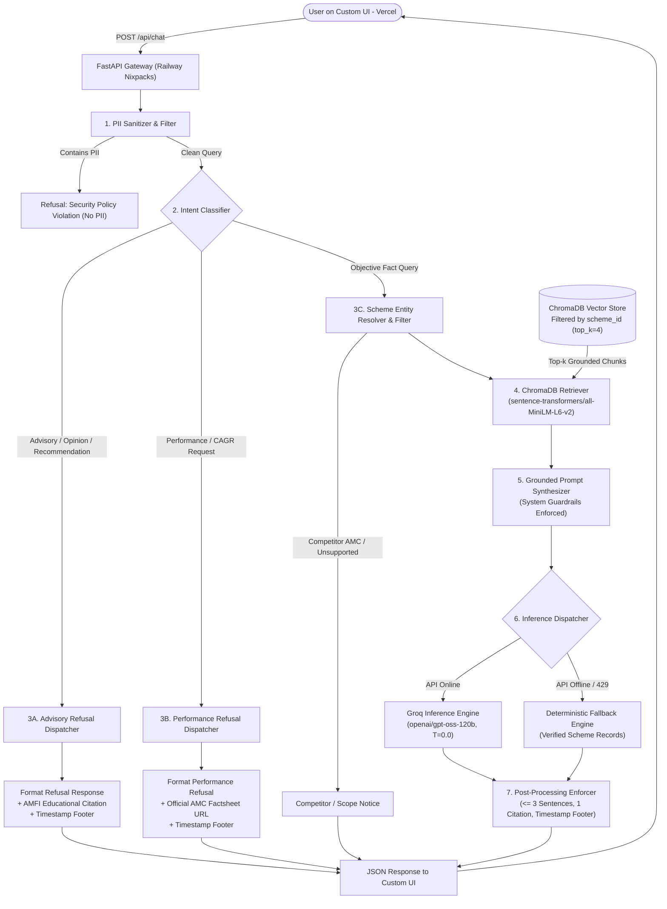
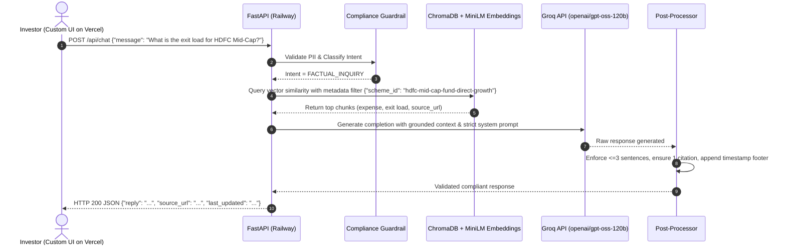
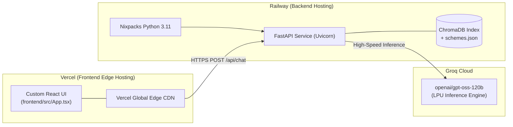

# System Architecture & Technical Design Document
## Fund Compass (Powered by Groww) — Mutual Fund Facts-Only FAQ Assistant

---

## 1. Document Control & Metadata

| Attribute | Details |
| :--- | :--- |
| **Project Name** | Fund Compass — Mutual Fund FAQ Assistant |
| **Reference Context** | Groww Mutual Fund Schemes (HDFC Mutual Fund Corpus) |
| **Document Version** | 2.1.0 (Audited System Architecture Specification) |
| **Status** | Approved Architectural Specification |
| **LLM Generator** | `openai/gpt-oss-120b` (via **Groq API**) with Deterministic Fallback Engine |
| **Vector Store & Embeddings** | **ChromaDB** SQLite persistent index using `sentence-transformers/all-MiniLM-L6-v2` |
| **Backend Runtime** | **FastAPI** (Python 3.11+), deployed on **Railway** via native Nixpacks |
| **Frontend UI** | **React 18 + Vite + Tailwind CSS**, deployed on **Vercel** Edge Network |
| **Core Directive** | **"Prioritize Accuracy Over Intelligence"** (Zero Hallucination, Zero Advisory) |

---

## 2. Architectural Overview & System Tiers

Fund Compass is architected as a distributed **4-Tier Decoupled System** separating the edge-hosted Custom Frontend on Vercel from the high-throughput FastAPI Backend on Railway:

```
┌────────────────────────────────────────────────────────────────────────┐
│             TIER 1: PRESENTATION LAYER (VERCEL DEPLOYMENT)             │
│   React 18 / Vite SPA (frontend/src/App.tsx) │ Vercel Edge Network     │
│   - Persistent Compliance Disclaimer: "Facts-only. No investment advice"│
│   - 3 Interactive Quick-Prompt Chips & Autocomplete Suggestions        │
│   - Markdown Message Renderer, Source Citations & Timestamp Footers    │
│   - In-app Compound Interest SIP Calculator & Multi-Theme Switcher     │
└───────────────────────────────────┬────────────────────────────────────┘
                                    │ HTTPS / REST API (`/api/chat`)
                                    │ CORS-Configured Origin
┌───────────────────────────────────▼────────────────────────────────────┐
│              TIER 2: BACKEND & API ROUTING (RAILWAY NIXPACKS)          │
│   FastAPI Service │ Pydantic Validation │ Inbound PII Sanitizer        │
│   Intent Classifier (Factual vs. Advisory / Performance / Out-of-Scope)│
└───────────────────┬─────────────────────────────────┬──────────────────┘
                    │ [If Advisory / Out-of-Scope]    │ [If Factual]
                    ▼                                 ▼
         ┌─────────────────────┐     ┌───────────────────────────────────┐
         │ Fast Refusal Engine │     │     TIER 3: RAG CORE ENGINE       │
         │ - Polite Refusal    │     │  Canonical Scheme Entity Resolver │
         │ - AMFI/SEBI Links   │     │  Competitor AMC / Category Filter │
         │ - Timestamp Footer  │     │  ChromaDB Metadata Vector Query   │
         │                     │     │  Groq API: openai/gpt-oss-120b    │
         │                     │     │  Deterministic Fallback Engine    │
         └──────────┬──────────┘     └─────────────────┬─────────────────┘
                    │                                  │
                    │                ┌─────────────────▼─────────────────┐
                    │                │   POST-PROCESSING SANITIZER       │
                    │                │  - Sentence Boundary Tokenizer    │
                    │                │  - Max 3 Sentences Hard Enforcer  │
                    │                │  - Exactly 1 Verified Source Link │
                    │                │  - Timestamp Footer Injection     │
                    │                └─────────────────┬─────────────────┘
                    │                                  │
                    └──────────────────┬───────────────┘
                                       │
┌──────────────────────────────────────▼─────────────────────────────────┐
│              TIER 4: EMBEDDING & KNOWLEDGE PERSISTENCE                 │
│   ChromaDB Vector Store │ sentence-transformers/all-MiniLM-L6-v2       │
│   4 Atomic Semantic Chunks / Scheme (20 Chunks Total) in ChromaDB      │
│   Normalized Scheme Fact Database (schemes.json & chunks.json)         │
│   *Note: Ingestion runs on curated static seed data (Scraper pending)  │
└────────────────────────────────────────────────────────────────────────┘
```

---

## 3. High-Level Component Flow



---

## 4. Subsystem Specifications

### 4.1 Tier 1: Custom UI (Deployed on Vercel)
The Custom Frontend is hosted on Vercel, providing an ultra-responsive, compliant interface:
- **Component Implementation:** Built as a single-page React 18 application centered in `frontend/src/App.tsx`, supported by `components/AutocompleteSuggestions.tsx` and `data/questionSuggestions.ts`.
- **Permanent Top Header:**  
  `"Fund Compass: Facts-only. No investment advice."`
- **Welcome Message Card:** Outlines the facts-only assistant role and lists the 5 supported schemes.
- **3 Interactive Quick-Prompt Chips:**
  1. *"What is the exit load for HDFC Mid-Cap Opportunities Fund?"*
  2. *"What is the lock-in period for HDFC ELSS Tax Saver Fund?"*
  3. *"What is the minimum SIP amount for HDFC Small Cap Fund?"*
- **Real-Time Autocomplete:** Suggests factual questions as the user types based on scheme attributes.
- **Message Rendering:** Displays formatted answer body, clickable single official source badge, and mandatory timestamp footer: `Last updated from sources: <YYYY-MM-DD>`.
- **Environment Configuration:** `VITE_API_BASE_URL` pointing to the Railway production endpoint.

---

### 4.2 Tier 2: Backend API & Guardrails (FastAPI on Railway)
FastAPI provides asynchronous, low-latency API handling deployed via native Nixpacks on Railway.

#### 1. Inbound PII Guardrail (`src/guardrails/pii_filter.py`)
- **Scanned Entities:** Indian PAN cards (`[A-Za-z]{5}[0-9]{4}[A-Za-z]{1}`), spaced and unspaced Aadhaar numbers (`\d{4}\s?\d{4}\s?\d{4}`), Bank Account/Folio IDs, OTPs, Phone numbers, and Email addresses.
- **Behavior:** Blocks processing immediately and returns a compliant privacy warning without invoking any LLM or vector retrieval.

#### 2. Intent Classification Engine (`src/guardrails/intent_classifier.py`)
Queries are parsed through deterministic regex and semantic heuristics before invoking the LLM:

| Intent Category | Query Examples | Execution Route |
| :--- | :--- | :--- |
| **`FACTUAL_INQUIRY`** | *"What is the expense ratio of HDFC Small Cap?"*, *"What is the benchmark of HDFC Top 100?"* | ChromaDB Vector Search $\rightarrow$ Groq LLM |
| **`ADVISORY_OR_OPINION`** | *"Should I invest in HDFC Mid-Cap?"*, *"Which fund is better: Small Cap or Mid Cap?"*, *"Predicted returns for next year?"* | Immediate Advisory Refusal Dispatcher |
| **`PERFORMANCE_REQUEST`** | *"What are the 3-year CAGR returns of this fund?"* | Official Factsheet Redirection Refusal |
| **`OUT_OF_SCOPE`** | *"Tell me a joke"*, *"What is the stock price of Apple?"* | Polite Scope Refusal |

#### 3. Standard Refusal Output
```text
I cannot provide investment advice, fund recommendations, or subjective comparisons. Fund Compass is strictly a facts-only assistant designed to provide verified mutual fund scheme information. For educational guidance on mutual funds, please visit the official AMFI portal: https://www.amfiindia.com/investor-corner/knowledge-center

Last updated from sources: 2026-11-10
```

---

### 4.3 Tier 3: RAG Core & Groq LLM Engine (`src/rag/`)



#### Grounded Inference with `openai/gpt-oss-120b` via Groq
- **Model:** `openai/gpt-oss-120b`
- **Inference Provider:** **Groq Cloud API** (LPU architecture providing ultra-fast generation with zero hallucination at $T=0.0$).
- **Autonomous Deterministic Fallback:** In the event of API key omission, rate-limiting (HTTP 429), or network dropouts, `src/rag/generator.py` transparently falls back to `_generate_fallback_factual_response()` to format verified facts from scheme records.
- **System Instruction Prompt:**
```text
You are "Fund Compass", a facts-only mutual fund assistant powered by Groww and verified official AMC sources.
Your responses must follow these STRICT RULES:
1. Base your answer EXCLUSIVELY on the provided CONTEXT. Do not speculate or use outside knowledge.
2. If the context does not contain the answer, state: "This factual information is not available in the current scheme records."
3. Length: Maximum of 3 sentences. Be direct, clear, and objective.
4. Citations: Include exactly ONE official source link at the end of the text.
5. Absolute Prohibition: NEVER give investment advice, opinions, rating comparisons, or return predictions.
6. If the user asks for daily fluctuating Net Asset Value (NAV), explain that NAV fluctuates daily after market close and can be checked directly on the official Groww factsheet link.
```

---

### 4.4 Tier 4: Ingestion, Chunking & Vector Storage (`src/ingestion/`)

#### 1. Data Ingestion Architecture & Current Implementation State
- **Current Data Source:** Curated static seed snapshot in `data/raw/hdfc_schemes_raw.json` and validated canonical data in `data/processed/schemes.json`.
- **Identified Gap / Missing Component:** Automated live web scraping (`scraper.py`) from the 5 Groww URLs is not currently implemented.
- **Normalization Engine (`normalizer.py`):** Enforces canonical schema types, validates all 10 core fields, and checks SEBI Riskometer enumerations.

#### 2. Granular Semantic Chunking (`chunker.py`)
Rather than arbitrary token splitting, each scheme is decomposed into **4 semantic metric chunks** (20 chunks total across the 5 schemes):
1. `fees`: Direct plan expense ratio and applicable exit load rules.
2. `limits`: Minimum SIP installment, minimum lumpsum investment, and statutory lock-in periods.
3. `risk_governance`: SEBI Riskometer classification, benchmark index, fund manager, and official AMC factsheet URL.
4. `operations`: Official procedure for downloading account statements and capital gains reports.
- **Constraints:** `MAX_EMBEDDING_TOKENS = 256` WordPiece tokens. Overlap is set to `0` tokens.
- **Metadata Tagging:** Every chunk contains `scheme_id`, `scheme_name`, `category`, `source_url`, `last_updated`, `chunk_type`, and `factsheet_url`.

#### 3. Vector Indexing & Embeddings (`indexer.py`)
- **Vector Database:** **ChromaDB** with persistent SQLite storage under `data/chroma_db/`.
- **Embedding Model:** `sentence-transformers/all-MiniLM-L6-v2` (384 dimensions).
- **Embedding Function Hierarchy:**
  - Option A: Native `sentence_transformers` (`SentenceTransformerEmbeddingFunction`)
  - Option B: ChromaDB built-in ONNX runtime (`ONNXMiniLM_L6_V2`)
  - Option C: ChromaDB default embedding function
- **Resilient Fallback:** Every indexing build exports `data/chroma_db/chunks.json` for lightweight in-memory retrieval when native vector engines are unavailable.

---

## 5. Technology Stack Selection & Justification

| Component | Selected Technology | Deployment Target | Justification |
| :--- | :--- | :--- | :--- |
| **Frontend UI** | **React 18 + Vite + Tailwind CSS** | **Vercel** | Edge global CDN distribution, sub-second initial load, customized UI matching Groww aesthetics with disclaimer chips. |
| **Backend API** | **FastAPI (Python 3.11+)** | **Railway** | High-performance asynchronous ASGI framework, native Pydantic validation, CORS middleware, auto-documented OpenAPI. |
| **LLM Inference** | **`openai/gpt-oss-120b`** | **Groq Cloud API** | 120-billion parameter open-weights model delivering near-instantaneous token generation via Groq LPUs with zero hallucination at $T=0.0$. |
| **Vector Store** | **ChromaDB** | **Railway (Mounted/In-Process)** | In-process, lightweight, persistent SQLite storage, zero external database setup overhead. |
| **Embeddings** | **`sentence-transformers/all-MiniLM-L6-v2`** | **Railway (In-Memory)** | Fast 384-dimensional dense vectors running locally on CPU with zero network API round-trip. |
| **Compliance Layer** | **Deterministic Regex + Guardrails** | **Railway** | Pre-retrieval interception guaranteeing $100\%$ refusal SLA for advisory and PII queries. |

---

## 6. Actual Directory & Codebase Layout

```
fundcompass-rag-chatbot/
├── .github/
│   └── workflows/
│       └── daily_ingestion.yml    # Daily 6:00 AM IST ingestion re-indexer (runs indexer.py)
├── .venv/                         # Python 3.11 Virtual Environment
├── assets/                        # Brand assets and documentation banners
├── data/
│   ├── raw/
│   │   └── hdfc_schemes_raw.json  # Static seed scheme snapshot
│   ├── processed/
│   │   └── schemes.json           # Canonical validated scheme parameters
│   └── chroma_db/                 # Persistent ChromaDB SQLite index & chunks.json
├── docs/
│   ├── problemstatement.md        # Comprehensive project context & compliance rules
│   ├── architecture.md            # System architecture document (this file)
│   ├── implementation-plan.md     # 9-phase engineering roadmap
│   ├── deployment.md              # Railway & Vercel deployment manual
│   ├── edge-case.md               # Adversarial and edge-case catalog
│   └── eval.md                    # Evaluation benchmarks and audit checklists
├── frontend/                      # Custom React 18 UI (Target: Vercel)
│   ├── src/
│   │   ├── App.tsx                # Consolidated UI (disclaimer, chips, chat, SIP calculator)
│   │   ├── main.tsx               # React entrypoint
│   │   ├── index.css              # Tailwind styling
│   │   ├── components/
│   │   │   └── AutocompleteSuggestions.tsx # Real-time prompt autocomplete component
│   │   └── data/
│   │       └── questionSuggestions.ts      # Curated scheme question suggestions
│   ├── package.json
│   ├── vite.config.ts             # Vite build configuration with /api proxy
│   └── vercel.json                # Vercel SPA rewrites and security headers
├── src/                           # Backend Application (Target: Railway)
│   ├── __init__.py
│   ├── config.py                  # Environment config (GROQ_API_KEY, paths, models)
│   ├── api/
│   │   ├── __init__.py
│   │   ├── main.py                # FastAPI app entrypoint, CORS, and root endpoint
│   │   ├── routes.py              # /api/chat, /api/health, /api/schemes
│   │   └── schemas.py             # Pydantic request & response models
│   ├── guardrails/
│   │   ├── __init__.py
│   │   ├── pii_filter.py          # Sensitive data blocker (PAN, Aadhaar, OTP, Phone)
│   │   ├── intent_classifier.py   # Intent classification (Factual vs Advisory vs Scope)
│   │   └── refusal_engine.py      # Standardized refusal responses & AMFI citations
│   ├── rag/
│   │   ├── __init__.py
│   │   ├── retriever.py           # ChromaDB retriever, scheme resolver & competitor filter
│   │   ├── generator.py           # Groq API client (openai/gpt-oss-120b) + fallback engine
│   │   └── postprocessor.py       # Sentence boundary tokenizer (<= 3), citation & footer enforcer
│   └── ingestion/
│       ├── __init__.py
│       ├── normalizer.py          # Schema validator for schemes.json
│       ├── chunker.py             # 4-chunk semantic metric chunker
│       └── indexer.py             # ChromaDB vector index builder & chunks.json exporter
├── tests/
│   ├── test_guardrails.py         # Unit tests for PII and advisory refusals
│   ├── test_constraints.py        # Automated sentence count, citation & footer checks
│   ├── test_ingestion.py          # Schema normalization and chunker tests
│   ├── test_rag.py                # Retrieval and generation tests
│   ├── test_edge_cases.py         # 28 adversarial edge cases and red-teaming benchmarks
│   ├── test_api.py                # FastAPI REST endpoint integration tests
│   └── test_smoke.py              # Quick smoke tests
├── railway.json                   # Native Nixpacks Railway deployment configuration
├── .env.example                   # Environment variable template
├── .gitignore                     # Git ignore rules
├── requirements.txt               # Backend dependencies
└── README.md                      # Production README & setup runbook
```

---

## 7. Deployment & Operational Architecture



### 7.1 Backend Deployment on Railway (Native Nixpacks)
- **Deployment Method:** Containerless build using Railway native Nixpacks (no Dockerfile required):
  ```json
  {
    "build": {
      "builder": "NIXPACKS",
      "nixpacksPlan": {
        "providers": ["python"],
        "variables": { "NIXPACKS_PYTHON_VERSION": "3.11" }
      }
    },
    "deploy": {
      "startCommand": "uvicorn src.api.main:app --host 0.0.0.0 --port $PORT --workers 2",
      "healthcheckPath": "/api/health"
    }
  }
  ```
- **Environment Variables on Railway:**
  - `GROQ_API_KEY`: Secret key for Groq Cloud API.
  - `GROQ_MODEL`: `openai/gpt-oss-120b`.
  - `CORS_ORIGINS`: Vercel frontend domain (e.g., `https://<YOUR_VERCEL_PROJECT>.vercel.app`).

### 7.2 Frontend Deployment on Vercel
- **Deployment Method:** Vercel Git integration pointing to `frontend/`.
- **Environment Variables on Vercel:**
  - `VITE_API_BASE_URL`: `https://<railway-app-name>.up.railway.app`

### 7.3 Scheduled Ingestion Workflow Notice
- **GitHub Actions Workflow:** `.github/workflows/daily_ingestion.yml` runs daily at 6:00 AM IST (00:30 UTC).
- **Operational Reality:** It executes `python -m src.ingestion.indexer`, re-building the vector index from repository data. It does **not** dynamically fetch live web data from Groww until a dedicated compliant scraping module is integrated.

---

## 8. Verification & Compliance Matrix

| Compliance Requirement | Technical Enforcement Mechanism | SLA |
| :--- | :--- | :---: |
| **No Investment Advice** | Pre-retrieval regex + keyword intent classifier rejecting advisory queries. | **100%** |
| **Zero PII Exposure** | Pre-retrieval regex scanning and blocking PAN, Aadhaar, OTPs, and phone numbers. | **100%** |
| **Max 3 Sentences** | Post-processing sentence tokenizer enforcing truncation to $\le 3$ sentences. | **100%** |
| **Single Citation Link** | Post-processing citation injection matching the exact verified scheme URL. | **100%** |
| **Last Updated Footer** | Automated footer injection `"Last updated from sources: <date>"` on every response. | **100%** |
| **Performance Factsheet Rule** | Refusal of computed returns with direct link to official AMC factsheet. | **100%** |

---

## 9. Summary

Fund Compass achieves its core mandate—**"Prioritize Accuracy Over Intelligence"**—through strict layered enforcement:
1. **Deterministic Guardrails** block PII and advisory questions prior to model interaction.
2. **ChromaDB with `sentence-transformers/all-MiniLM-L6-v2`** isolates scheme contexts.
3. **`openai/gpt-oss-120b` via Groq API** provides low-latency generation grounded strictly in context, backed by an autonomous deterministic fallback engine.
4. **Post-Processing Constraints** guarantee compliance with regulatory length and citation formatting standards.
