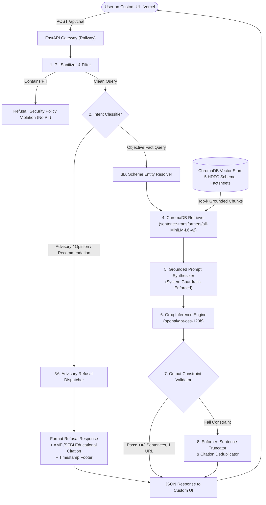
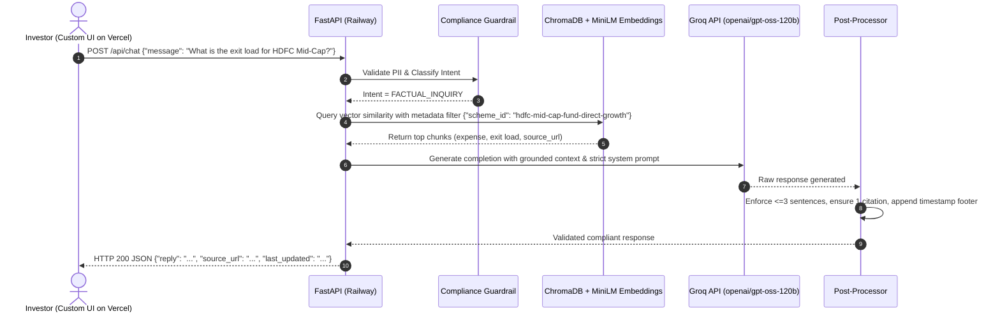
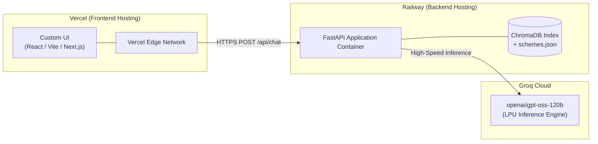

# System Architecture & Technical Design Document
## Fund Compass (Powered by Groww) — Mutual Fund Facts-Only FAQ Assistant

---

## 1. Document Control & Metadata

| Attribute | Details |
| :--- | :--- |
| **Project Name** | Fund Compass — Mutual Fund FAQ Assistant |
| **Reference Context** | Groww Mutual Fund Schemes (HDFC Mutual Fund Corpus) |
| **Document Version** | 2.0.0 (Finalized Technology Stack Specification) |
| **Status** | Approved Architectural Specification |
| **LLM Generator** | `openai/gpt-oss-120b` (via **Groq API**) |
| **Vector Store & Embeddings** | **ChromaDB** using `sentence-transformers/all-MiniLM-L6-v2` |
| **Backend Runtime** | **FastAPI** (Python 3.11+), deployed on **Railway** |
| **Frontend UI** | **Custom UI**, deployed on **Vercel** |
| **Core Directive** | **"Prioritize Accuracy Over Intelligence"** (Zero Hallucination, Zero Advisory) |

---

## 2. Architectural Overview & System Tiers

Fund Compass is architected as a distributed **4-Tier Decoupled System** separating the edge-hosted Custom Frontend on Vercel from the high-throughput FastAPI Backend on Railway:

```
┌────────────────────────────────────────────────────────────────────────┐
│             TIER 1: PRESENTATION LAYER (VERCEL DEPLOYMENT)             │
│   Custom Web UI (React/Next.js/Vite) │ Vercel Edge Global CDN          │
│   - Persistent Compliance Disclaimer: "Facts-only. No investment advice"│
│   - 3 Interactive Quick-Prompt Chips                                   │
│   - Streaming Markdown Chat Container & Verified Citation Badges      │
└───────────────────────────────────┬────────────────────────────────────┘
                                    │ HTTPS / REST API (`/api/chat`)
                                    │ CORS-Configured Origin
┌───────────────────────────────────▼────────────────────────────────────┐
│              TIER 2: BACKEND & API ROUTING (RAILWAY DEPLOYMENT)        │
│   FastAPI Service │ Pydantic Validation │ Inbound PII Sanitizer        │
│   Intent Classifier (Factual vs. Advisory/Comparison/Out-of-Scope)     │
└───────────────────┬─────────────────────────────────┬──────────────────┘
                    │ [If Advisory / Out-of-Scope]    │ [If Factual]
                    ▼                                 ▼
         ┌─────────────────────┐     ┌───────────────────────────────────┐
         │ Fast Refusal Engine │     │     TIER 3: RAG CORE ENGINE       │
         │ - Polite Refusal    │     │  Canonical Scheme Entity Resolver │
         │ - AMFI/SEBI Links   │     │  ChromaDB Vector Retrieval        │
         │ - Timestamp Footer  │     │  Grounded Context Prompt Builder  │
         │                     │     │  Groq API: openai/gpt-oss-120b    │
         └──────────┬──────────┘     └─────────────────┬─────────────────┘
                    │                                  │
                    │                ┌─────────────────▼─────────────────┐
                    │                │   POST-PROCESSING SANITIZER       │
                    │                │  - Max 3 Sentences Hard Enforcer  │
                    │                │  - Exactly 1 Verified Source Link │
                    │                │  - Timestamp Footer Injection     │
                    │                └─────────────────┬─────────────────┘
                    │                                  │
                    └──────────────────┬───────────────┘
                                       │
┌──────────────────────────────────────▼─────────────────────────────────┐
│              TIER 4: EMBEDDING & KNOWLEDGE PERSISTENCE                 │
│   ChromaDB Vector Store │ sentence-transformers/all-MiniLM-L6-v2       │
│   Normalized Scheme Fact Database (schemes.json)                       │
└────────────────────────────────────────────────────────────────────────┘
```

---

## 3. High-Level Component Flow



---

## 4. Subsystem Specifications

### 4.1 Tier 1: Custom UI (Deployed on Vercel)
The Custom Frontend is hosted on Vercel, providing an ultra-responsive, compliant interface:
- **Permanent Top Header:**  
  `"Fund Compass: Facts-only. No investment advice."`
- **Welcome Message Card:** Outlines the facts-only assistant role and list of supported schemes.
- **3 Interactive Quick-Prompt Chips:**
  1. *"What is the exit load for HDFC Mid-Cap Opportunities Fund?"*
  2. *"What is the lock-in period for HDFC ELSS Tax Saver Fund?"*
  3. *"What is the minimum SIP amount for HDFC Small Cap Fund?"*
- **Message Rendering:** Displays formatted answer body, clickable single official source badge, and the mandatory timestamp footer: `Last updated from sources: <YYYY-MM-DD>`.
- **Environment Configuration:** `NEXT_PUBLIC_API_URL` / `VITE_API_URL` pointing to the Railway production endpoint.

---

### 4.2 Tier 2: Backend API & Guardrails (FastAPI on Railway)
FastAPI provides asynchronous, low-latency API handling deployed as a containerized service on Railway.

#### 1. Inbound PII Guardrail
- **Scanned Entities:** Indian PAN numbers (`[A-Z]{5}[0-9]{4}[A-Z]{1}`), Aadhaar numbers (`\d{4}\s?\d{4}\s?\d{4}`), Bank Account/Folio IDs, OTPs, Phone numbers, and Email addresses.
- **Behavior:** Blocks processing and returns a compliant privacy warning.

#### 2. Intent Classification Engine
Queries are parsed through deterministic regex and semantic heuristics before invoking the LLM:

| Intent Category | Query Examples | Execution Route |
| :--- | :--- | :--- |
| **`FACTUAL_INQUIRY`** | *"What is the expense ratio of HDFC Small Cap?"*, *"What is the benchmark of HDFC Top 100?"* | ChromaDB Vector Search $\rightarrow$ Groq LLM |
| **`ADVISORY_OR_OPINION`** | *"Should I invest in HDFC Mid-Cap?"*, *"Which fund is better: Small Cap or Mid Cap?"*, *"Predicted returns for next year?"* | Immediate Refusal Dispatcher |
| **`PERFORMANCE_REQUEST`** | *"What are the 3-year CAGR returns of this fund?"* | Official Factsheet Redirection Refusal |
| **`OUT_OF_SCOPE`** | *"Tell me a joke"*, *"What is the stock price of Apple?"* | Polite Scope Refusal |

#### 3. Standard Refusal Output
```text
I cannot provide investment advice, fund recommendations, or subjective comparisons. Fund Compass is strictly a facts-only assistant designed to provide verified mutual fund scheme information. For educational guidance on mutual funds, please visit the official AMFI portal: https://www.amfiindia.com/investor-corner/knowledge-center

Last updated from sources: 2026-11-10
```

---

### 4.3 Tier 3: RAG Core & Groq LLM Engine



#### Grounded Inference with `openai/gpt-oss-120b` via Groq
- **Model:** `openai/gpt-oss-120b`
- **Inference Provider:** **Groq Cloud API** (LPU architecture providing ultra-fast tokens-per-second, drastically minimizing round-trip chat latency).
- **Temperature:** `0.0` (Deterministic, zero-creativity mode to eliminate hallucination).
- **System Instruction Prompt:**
```text
You are "Fund Compass", a facts-only mutual fund assistant powered by Groww and verified official AMC sources.
Your responses must follow these STRICT RULES:
1. Base your answer EXCLUSIVELY on the provided CONTEXT. Do not speculate or use outside knowledge.
2. If the context does not contain the answer, state: "This factual information is not available in the current scheme records."
3. Length: Maximum of 3 sentences. Be direct, clear, and objective.
4. Citations: Include exactly ONE official source link at the end of the text.
5. Absolute Prohibition: NEVER give investment advice, opinions, rating comparisons, or return predictions.
```

---

### 4.4 Tier 4: ChromaDB & Embedding Engine

- **Vector Database:** **ChromaDB**
- **Embedding Model:** `sentence-transformers/all-MiniLM-L6-v2` (384 dimensions, local execution, zero API dependencies, highly accurate semantic retrieval).
- **Corpus Data:** 5 Seed HDFC Mutual Fund Schemes on Groww:
  1. HDFC Mid-Cap Opportunities Fund (Direct - Growth)
  2. HDFC Small Cap Fund (Direct - Growth)
  3. HDFC Gold ETF Fund of Fund (Direct Plan - Growth)
  4. HDFC Top 100 / Large Cap Fund (Direct - Growth)
  5. HDFC ELSS Tax Saver Fund (Direct Plan - Growth)
- **Metadata Filtering:** Queries are tagged by `scheme_id` ensuring strict isolation between schemes and eliminating cross-fund leakage.

---

## 5. Technology Stack Selection & Justification

| Component | Selected Technology | Deployment Target | Justification |
| :--- | :--- | :--- | :--- |
| **Frontend UI** | **Custom Web UI (React/Next.js/Vite + Tailwind)** | **Vercel** | Edge global CDN distribution, rapid page loads, customized UI matching Groww aesthetics with disclaimer chips. |
| **Backend API** | **FastAPI (Python 3.11+)** | **Railway** | High-performance asynchronous ASGI framework, native Pydantic validation, CORS middleware, auto-documented OpenAPI. |
| **LLM Inference** | **`openai/gpt-oss-120b`** | **Groq Cloud API** | 120-billion parameter open-weights model delivering near-instantaneous token generation via Groq LPUs with zero hallucination at $T=0.0$. |
| **Vector Store** | **ChromaDB** | **Railway (Embedded/Mounted)** | In-process, lightweight, persistent SQLite storage, zero external database setup overhead. |
| **Embeddings** | **`sentence-transformers/all-MiniLM-L6-v2`** | **Railway (In-Memory)** | Fast 384-dimensional dense vectors running locally on CPU with zero network API round-trip. |
| **Compliance Layer** | **Deterministic Regex + Guardrails** | **Railway** | Pre-retrieval interception guaranteeing $100\%$ refusal SLA for advisory and PII queries. |

---

## 6. Directory & Codebase Layout

```
fundcompass-rag-chatbot/
├── .venv/                         # Python 3.11 Virtual Environment
├── docs/
│   ├── problemstatement.txt       # Original prompt specification
│   ├── problemstatement.md        # Comprehensive project context
│   └── architecture.md            # System architecture document (this file)
├── data/
│   ├── raw/                       # Cached scheme snapshots
│   ├── processed/
│   │   └── schemes.json           # Validated, structured scheme facts
│   └── chroma_db/                 # Persistent ChromaDB vector index
├── frontend/                      # Custom UI (Target: Vercel)
│   ├── src/
│   │   ├── components/
│   │   │   ├── Header.tsx         # Compliance disclaimer banner
│   │   │   ├── ChatWindow.tsx     # Message list & citation renderer
│   │   │   ├── PromptChips.tsx    # 3 quick-action questions
│   │   │   └── ChatInput.tsx      # User input field
│   │   ├── App.tsx
│   │   └── api.ts                 # Axios / Fetch client to Railway backend
│   ├── package.json
│   ├── vite.config.ts / next.config.js
│   └── vercel.json                # Vercel deployment configuration
├── src/                           # Backend Application (Target: Railway)
│   ├── __init__.py
│   ├── config.py                  # Environment config (GROQ_API_KEY, paths)
│   ├── api/
│   │   ├── __init__.py
│   │   ├── main.py                # FastAPI application entrypoint & CORS
│   │   ├── routes.py              # /api/chat, /api/health, /api/schemes
│   │   └── schemas.py             # Pydantic request & response models
│   ├── guardrails/
│   │   ├── __init__.py
│   │   ├── pii_filter.py          # Sensitive data blocker (PAN, Aadhaar, OTP)
│   │   ├── intent_classifier.py   # Query classifier (Factual vs Advisory)
│   │   └── refusal_engine.py      # Standardized refusal responses
│   ├── rag/
│   │   ├── __init__.py
│   │   ├── retriever.py           # ChromaDB retriever + all-MiniLM-L6-v2
│   │   ├── generator.py           # Groq API client (openai/gpt-oss-120b)
│   │   └── postprocessor.py       # Sentence truncator (<= 3) & citation enforcer
│   └── ingestion/
│       ├── __init__.py
│       ├── normalizer.py          # Schema validator for schemes.json
│       └── indexer.py             # ChromaDB vector index builder
├── tests/
│   ├── test_guardrails.py         # Unit tests for PII and advisory refusals
│   ├── test_retriever.py          # Unit tests for scheme matching & retrieval
│   └── test_constraints.py        # Automated sentence count & citation checks
├── Dockerfile                     # Railway container deployment
├── railway.json                   # Railway deployment configuration
├── .env.example                   # Environment variable template
├── .gitignore
├── requirements.txt               # Backend dependencies
└── README.md                      # Setup and deployment instructions
```

---

## 7. Deployment & Operational Architecture



### 7.1 Backend Deployment on Railway
- **Deployment Method:** Dockerfile or Railway Procfile running Uvicorn:
  ```bash
  uvicorn src.api.main:app --host 0.0.0.0 --port $PORT
  ```
- **Environment Variables on Railway:**
  - `GROQ_API_KEY`: Secret key for Groq Cloud API.
  - `GROQ_MODEL`: `openai/gpt-oss-120b`.
  - `CORS_ORIGINS`: Vercel frontend domain (e.g., `https://<YOUR_VERCEL_PROJECT>.vercel.app`).

### 7.2 Frontend Deployment on Vercel
- **Deployment Method:** Vercel Git integration or Vercel CLI.
- **Environment Variables on Vercel:**
  - `VITE_API_BASE_URL` (or `NEXT_PUBLIC_API_BASE_URL`): `https://<railway-app-name>.up.railway.app`

---

## 8. Verification & Compliance Matrix

| Compliance Requirement | Technical Enforcement Mechanism | SLA |
| :--- | :--- | :---: |
| **No Investment Advice** | Pre-retrieval regex + keyword intent classifier rejecting advisory queries. | **100%** |
| **Zero PII Exposure** | Pre-retrieval regex scanning and blocking PAN, Aadhaar, OTPs, and phone numbers. | **100%** |
| **Max 3 Sentences** | Post-processing sentence tokenizer enforcing truncation to $\le 3$ sentences. | **100%** |
| **Single Citation Link** | Post-processing citation injection matching the exact verified scheme URL. | **100%** |
| **Last Updated Footer** | Automated footer injection `"Last updated from sources: <date>"` on every response. | **100%** |
| **Performance Factsheet Rule** | Refusal of computed returns with direct link to official AMC factsheet. | **100%** |

---

## 9. Summary

With the finalized stack:
- **`openai/gpt-oss-120b` via Groq API** ensures lightning-fast, high-precision generation with zero hallucinations under temperature 0.0.
- **ChromaDB with `sentence-transformers/all-MiniLM-L6-v2`** provides localized, zero-cost semantic search.
- **FastAPI on Railway** serves clean, auto-validated REST endpoints with strict guardrails.
- **Custom UI on Vercel** provides an accessible user interface displaying compliance disclaimers and starter prompts.
