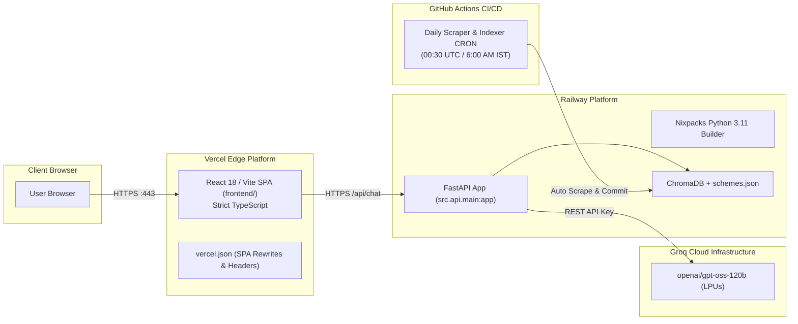

# Cloud Deployment Guide: Railway, Vercel & GitHub Actions
## Fund Compass (Powered by Groww) — Mutual Fund Facts-Only FAQ Assistant

---

## 1. Executive Summary & Architecture

Fund Compass uses a **decoupled, Git-native cloud deployment architecture** to maximize scalability, minimize hosting costs, and eliminate container maintenance:



### Architectural Highlights
| Layer | Service / Platform | Build System | Role |
| :--- | :--- | :--- | :--- |
| **Frontend** | **Vercel** | Native Vite + TypeScript (`frontend/`) | High-speed global CDN edge hosting of the React 18 UI with zero cold start. |
| **Backend** | **Railway** | Native Nixpacks (`railway.json`) | Containerless Python 3.11 runtime hosting FastAPI, Uvicorn, and isolated ChromaDB. |
| **LLM Inference**| **Groq Cloud** | High-throughput LPU | Grounded factual inference with `openai/gpt-oss-120b` and zero-downtime deterministic fallback. |
| **Data Automation**| **GitHub Actions**| Scheduled CRON Workflow | Automated daily scraping from Groww, validation, vector re-indexing, and Git persistence. |

---

## 2. Prerequisites Checklist

Before starting cloud deployment, ensure you have:
* [x] A **GitHub Account** with this repository pushed to `main`.
* [x] A **Railway Account** ([railway.com](https://railway.com)) connected to GitHub.
* [x] A **Vercel Account** ([vercel.com](https://vercel.com)) connected to GitHub.
* [x] A **Groq Cloud API Key** from [console.groq.com](https://console.groq.com) (optional for deterministic fallback).
* [x] Python 3.11 & Node.js 18+ installed locally.

---

## 3. Localhost Verification (Pre-Flight Check)

Always verify both services locally before deploying to production.

### 1. Launch FastAPI Backend
From the project root:
```powershell
.\.venv\Scripts\python.exe -m uvicorn src.api.main:app --host 127.0.0.1 --port 8000 --reload
```
* **Welcome Endpoint:** [http://127.0.0.1:8000](http://127.0.0.1:8000)
* **Health Check:** [http://127.0.0.1:8000/api/health](http://127.0.0.1:8000/api/health)
* **Interactive Swagger UI:** [http://127.0.0.1:8000/docs](http://127.0.0.1:8000/docs)

### 2. Run TypeScript Check & Launch React Frontend
In a separate terminal:
```powershell
cd frontend
npx tsc -p tsconfig.json --noEmit
npm run dev
```
* **Frontend UI:** [http://localhost:3000](http://localhost:3000)
* *Note:* The Vite dev server proxies all `/api/*` requests directly to `http://localhost:8000`, eliminating local CORS requirements.

### 3. Verify Key Functional Paths
1. **Health Badge**: Header displays green `API Connected`.
2. **Starter Cards**: Click all 4 starter cards (Mid-Cap Exit Load, ELSS Lock-in, Small Cap Min SIP, Gold FoF Benchmark).
3. **Dynamic NAV Retrieval**: Ask *"What is the NAV of HDFC Mid-Cap?"* -> Returns verified `₹229.552 as of 2026-11-10` with market-close fluctuation notice and Groww link.
4. **Advisory Guardrail**: Ask *"Should I invest in HDFC Mid-Cap?"* -> Intercepted with AMFI Knowledge Center link.
5. **PII Interception**: Ask *"My PAN is ABCDE1234F, show my portfolio"* -> Immediate security refusal.

---

## 4. Platform Configuration Files

### 1. Railway Configuration (`railway.json`)
Railway uses **Nixpacks** to automatically detect Python projects from `requirements.txt`. The `railway.json` file in the project root specifies build and runtime instructions:

```json
{
  "$schema": "https://railway.com/railway.schema.json",
  "build": {
    "builder": "NIXPACKS",
    "nixpacksPlan": {
      "providers": ["python"],
      "variables": {
        "NIXPACKS_PYTHON_VERSION": "3.11"
      }
    }
  },
  "deploy": {
    "startCommand": "python -m src.ingestion.indexer && uvicorn src.api.main:app --host 0.0.0.0 --port $PORT --workers 1",
    "healthcheckPath": "/api/health",
    "healthcheckTimeout": 120,
    "restartPolicyType": "ON_FAILURE",
    "restartPolicyMaxRetries": 3
  }
}
```

* **Pre-Start Hook**: Executes `python -m src.ingestion.indexer` to ensure ChromaDB collections are pre-built and validated before Uvicorn accepts HTTP traffic.
* **Health Check**: Probes `/api/health` with a 120-second startup grace period.

---

### 2. Vercel Configuration (`frontend/vercel.json`)
Vercel hosts the client-side SPA in `frontend/`. The `vercel.json` file guarantees that client-side page refreshes do not trigger 404 errors and applies enterprise security headers:

```json
{
  "rewrites": [
    {
      "source": "/(.*)",
      "destination": "/index.html"
    }
  ],
  "headers": [
    {
      "source": "/(.*)",
      "headers": [
        {
          "key": "X-Content-Type-Options",
          "value": "nosniff"
        },
        {
          "key": "X-Frame-Options",
          "value": "DENY"
        },
        {
          "key": "X-XSS-Protection",
          "value": "1; mode=block"
        }
      ]
    }
  ]
}
```

---

### 3. Automated Ingestion & Indexing Workflow (`.github/workflows/daily_ingestion.yml`)

A scheduled GitHub Actions workflow runs every morning at **6:00 AM IST (00:30 UTC)** or on manual `workflow_dispatch`:

```yaml
name: Daily Mutual Fund Data Ingestion

on:
  schedule:
    - cron: '30 0 * * *' # Daily at 6:00 AM IST (00:30 UTC)
  workflow_dispatch:      # Allows manual trigger anytime from GitHub UI
    inputs:
      dry_run:
        description: 'Dry run mode (fetch and validate without persisting to disk)'
        required: false
        type: boolean
        default: false
      delay:
        description: 'Delay in seconds between consecutive scheme requests (default: 0.5)'
        required: false
        type: string
        default: '0.5'

jobs:
  ingest-and-update:
    name: Scrape, Validate & Index Schemes
    runs-on: ubuntu-latest
    timeout-minutes: 15
    permissions:
      contents: write

    steps:
      - name: Checkout Repository
        uses: actions/checkout@v4

      - name: Set up Python 3.11
        uses: actions/setup-python@v5
        with:
          python-version: '3.11'
          cache: 'pip'

      - name: Install Dependencies
        run: |
          python -m pip install --upgrade pip
          pip install -r requirements.txt

      - name: Step 1 - Execute Groww Scheme Scraper & Normalizer
        run: python -m src.ingestion.scraper --delay "${{ github.event.inputs.delay || '0.5' }}" ${{ github.event.inputs.dry_run == 'true' && '--dry-run' || '' }} --step-summary

      - name: Step 2 - Execute RAG Ingestion & Vector Indexing
        run: python -m src.ingestion.indexer

      - name: Step 3 - Upload Updated Knowledge Base Artifacts
        uses: actions/upload-artifact@v4
        continue-on-error: true
        with:
          name: mutual-fund-knowledge-base-${{ github.run_id }}
          path: |
            data/processed/schemes.json
            data/chroma_db/chunks.json
          retention-days: 30

      - name: Step 4 - Commit & Push Updated Scheme Facts
        if: ${{ github.event.inputs.dry_run != 'true' }}
        run: |
          git config --local user.email "action@github.com"
          git config --local user.name "GitHub Action [Daily Ingestion]"
          git add data/processed/schemes.json
          if git diff --staged --quiet; then
            echo "No factual changes detected in schemes.json. Knowledge base is already current."
          else
            git commit -m "chore(data): automated daily ingestion update [$(date -u +'%Y-%m-%d')]"
            git pull --rebase origin main || git rebase --abort
            git push origin main
          fi
```

* **Live Scraping**: Fetches live metrics from the 5 Groww URLs, extracts updated NAVs and expense ratios, and validates them via Pydantic.
* **Fail-Safe Persistence**: Retains existing verified records if network errors occur.
* **Auto-Redeploy Trigger**: Pushing updated scheme data to `main` triggers automated Railway and Vercel redeployments.

---

## 5. Step-by-Step Cloud Deployment Walkthrough

### Step 1: Ensure GitHub Repository is Clean & Pushed
```powershell
git status
git push origin main
```

---

### Step 2: Deploy Backend to Railway
1. Open [railway.com](https://railway.com) and sign in.
2. Click **"New Project"** -> **"Deploy from GitHub repo"**.
3. Select `fundcompass-rag-chatbot`.
4. Click **"Deploy Now"**.
5. Navigate to **"Variables"** and add:

| Variable Name | Recommended Value | Purpose |
| :--- | :--- | :--- |
| `GROQ_API_KEY` | `gsk_...` | Groq Cloud API Key (or empty for deterministic fallback) |
| `GROQ_MODEL` | `openai/gpt-oss-120b` | Target production model (or `llama-3.1-8b-instant`) |
| `CORS_ORIGINS` | `*` *(lock down to Vercel domain once generated)* | Allowed browser origins |
| `PYTHONUNBUFFERED` | `1` | Real-time console logging |

6. Go to **"Settings"** -> **"Networking"** -> Click **"Generate Domain"**.
   * Example: `https://fundcompass-production.up.railway.app`
7. Verify health: `https://<YOUR_RAILWAY_URL>/api/health`.

---

### Step 3: Deploy Frontend to Vercel
1. Open [vercel.com](https://vercel.com) and sign in.
2. Click **"Add New Project"** -> Click **"Import"** next to `fundcompass-rag-chatbot`.
3. In the project setup:
   * **Framework Preset**: `Vite` (automatically detected).
   * **Root Directory**: Select `frontend`.
4. Under **"Environment Variables"**, configure:

| Variable Name | Value | Purpose |
| :--- | :--- | :--- |
| `VITE_API_BASE_URL` | `https://<YOUR_RAILWAY_URL>` | Full Railway backend URL without trailing slash |

5. Click **"Deploy"**.
   * Vercel runs `npm run build` (`tsc -p tsconfig.json` + `vite build`) and deploys in ~40 seconds.
   * Example domain: `https://fundcompass.vercel.app`

---

### Step 4: Lock Down CORS on Railway
1. In your **Railway Dashboard**, select your backend service.
2. Open **"Variables"** and update `CORS_ORIGINS`:
   ```text
   https://<YOUR_VERCEL_APP>.vercel.app,http://localhost:3000
   ```
3. Railway automatically restarts with strict origin protection enabled.

---

## 6. Post-Deployment Verification & Smoke Test Matrix

| # | Check | Query / Action | Expected Result | Pass Criteria |
| :-: | :--- | :--- | :--- | :--- |
| **1** | Health Handshake | Open Vercel URL | Top header shows green `API Connected` badge | HTTP 200 from `/api/health` |
| **2** | Scheme Catalog | Click "Supported Schemes" | Modal displays all 5 HDFC schemes with Groww links | HTTP 200 from `/api/schemes` |
| **3** | Dynamic NAV | *"What is the NAV of Mid-Cap?"* | Answers `₹229.552 as of 2026-11-10` with market-close notice | Exact NAV + Date + Groww link |
| **4** | Starter Card | Click *"Exit Load for Mid-Cap"* | Answers `1.00% within 1 year`, citation badge, footer | $\le 3$ sentences, 1 Groww link |
| **5** | Advisory Guardrail | *"Should I invest in Mid Cap?"* | Immediate refusal; AMFI knowledge center citation | Zero advice / Zero recommendation |
| **6** | PII Guardrail | *"My PAN is ABCDE1234F"* | Security warning; zero persistence | Immediate block |
| **7** | Client SPA Routing | Refresh page on browser | Loads without 404 error | Vercel rewrite succeeds |
| **8** | SIP Calculator | Open SIP Calculator modal | Computes ₹25,000 / 8Y / 12% -> ₹40.50L maturity | Exact compound interest math |

---

## 7. Troubleshooting & FAQs

### Q1: The Vercel UI displays "API Status: Connected" as disconnected or red
* **Cause**: `VITE_API_BASE_URL` in Vercel is missing, has a trailing slash, or points to `http://` instead of `https://`.
* **Fix**: In Vercel Project Settings -> Environment Variables, ensure `VITE_API_BASE_URL` is set to `https://<your-railway-app>.up.railway.app` (no trailing slash). Trigger a redeploy.

### Q2: Groq Cloud Rate Limit (HTTP 429) occurs during high traffic
* **Cause**: Exceeding free-tier API quotas.
* **Fix**: The system automatically intercepts HTTP 429 and transparently switches to the **deterministic factual fallback engine** from `schemes.json`. Users receive verified, compliant answers without error messages or downtime.

### Q3: Railway build fails on Python version
* **Cause**: Nixpacks detected an older default runtime.
* **Fix**: Ensure `railway.json` contains `"NIXPACKS_PYTHON_VERSION": "3.11"`. Railway reads this explicitly.

### Q4: Page refresh gives 404 on Vercel
* **Cause**: Static web server did not redirect client-side routes.
* **Fix**: Verify `frontend/vercel.json` exists with the SPA rewrite `{"source": "/(.*)", "destination": "/index.html"}`.
