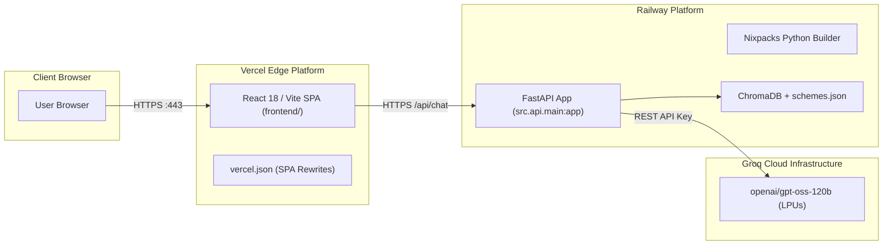

# Cloud Deployment Guide: Railway & Vercel
## Fund Compass (Powered by Groww) — Mutual Fund Facts-Only FAQ Assistant

---

## 1. Executive Summary & Architecture

Fund Compass uses a **decoupled, Git-native cloud deployment architecture** to maximize scalability, minimize hosting costs, and completely eliminate Dockerfile maintenance.



### Architectural Highlights
| Layer | Service / Platform | Build System | Role |
| :--- | :--- | :--- | :--- |
| **Frontend** | **Vercel** | Native Vite Build (`frontend/`) | High-speed global CDN edge hosting of the React 18 UI with zero cold start. |
| **Backend** | **Railway** | Native Nixpacks (`railway.json`) | Containerless Python 3.11 runtime hosting FastAPI, Uvicorn, and isolated ChromaDB. |
| **LLM Inference**| **Groq Cloud** | High-throughput LPU | Grounded factual inference with `openai/gpt-oss-120b` and deterministic fallback. |
| **CI/CD** | **GitHub** | Webhook Automation | Push-to-deploy pipeline automatically redeploying Railway & Vercel upon Git push. |

---

## 2. Prerequisites Checklist

Before starting cloud deployment, ensure you have:

* [ ] A **GitHub Account** with Git configured locally.
* [ ] A **Railway Account** ([railway.com](https://railway.com)) connected to your GitHub.
* [ ] A **Vercel Account** ([vercel.com](https://vercel.com)) connected to your GitHub.
* [ ] A **Groq Cloud API Key** from [console.groq.com](https://console.groq.com).
* [ ] Python 3.11 & Node.js 18+ installed locally.

---

## 3. Stage 8A: Localhost Verification (Pre-Flight Check)

Always verify both services locally before deploying to production.

### 1. Launch FastAPI Backend
From the project root:
```powershell
.venv\Scripts\python.exe -m uvicorn src.api.main:app --host 127.0.0.1 --port 8000 --reload
```
* **Welcome Endpoint:** [http://127.0.0.1:8000](http://127.0.0.1:8000)
* **Health Check:** [http://127.0.0.1:8000/api/health](http://127.0.0.1:8000/api/health)
* **Interactive Swagger UI:** [http://127.0.0.1:8000/docs](http://127.0.0.1:8000/docs)

### 2. Launch React Frontend
In a separate terminal:
```powershell
cd frontend
npm run dev
```
* **Frontend UI:** [http://localhost:3000](http://localhost:3000)
* *Note:* The Vite dev server proxies all `/api/*` requests directly to `http://localhost:8000`, eliminating local CORS requirements.

### 3. Verify Key Functional Paths
1. Click all 3 starter chips (Mid-Cap Exit Load, ELSS Lock-in, Small Cap Min SIP).
2. Ask a factual question: *"What is the expense ratio of HDFC Small Cap?"*
3. Test advisory refusal: *"Should I invest in HDFC Mid-Cap?"*
4. Test PII interception: *"My PAN is ABCDE1234F, show my account."*

---

## 4. Stage 8B: Platform Configuration Files

### 1. Railway Configuration (`railway.json`)
Railway uses **Nixpacks** to automatically detect Python projects from `requirements.txt`. The `railway.json` file in the project root specifies build and runtime instructions:

```json
{
  "$schema": "https://railway.com/railway.schema.json",
  "build": {
    "builder": "NIXPACKS",
    "nixpacksPlan": {
      "providers": ["python"],
      "variables": {
        "NIXPACKS_PYTHON_VERSION": "3.11"
      }
    }
  },
  "deploy": {
    "startCommand": "uvicorn src.api.main:app --host 0.0.0.0 --port $PORT --workers 2",
    "healthcheckPath": "/api/health",
    "healthcheckTimeout": 120,
    "restartPolicyType": "ON_FAILURE",
    "restartPolicyMaxRetries": 3
  }
}
```

### 2. Vercel Configuration (`frontend/vercel.json`)
Vercel hosts the client-side SPA in `frontend/`. The `vercel.json` file guarantees that client-side page refreshes do not trigger 404 errors:

```json
{
  "$schema": "https://openapi.vercel.sh/vercel.json",
  "rewrites": [
    {
      "source": "/(.*)",
      "destination": "/index.html"
    }
  ],
  "headers": [
    {
      "source": "/assets/(.*)",
      "headers": [
        {
          "key": "Cache-Control",
          "value": "public, max-age=31536000, immutable"
        }
      ]
    }
  ]
}
```

### 3. Automated Ingestion & Indexing Workflow (`.github/workflows/daily_ingestion.yml`)

A scheduled GitHub Actions workflow is configured to run every morning at **6:00 AM IST (00:30 UTC)** or on manual `workflow_dispatch`:

```yaml
name: Daily Mutual Fund Data Ingestion

on:
  schedule:
    - cron: '30 0 * * *' # Daily at 6:00 AM IST (00:30 UTC)
  workflow_dispatch:      # Allows manual trigger anytime from GitHub UI

jobs:
  ingest-and-update:
    runs-on: ubuntu-latest
    permissions:
      contents: write

    steps:
      - name: Checkout Repository
        uses: actions/checkout@v4

      - name: Set up Python 3.11
        uses: actions/setup-python@v5
        with:
          python-version: '3.11'
          cache: 'pip'

      - name: Install Dependencies
        run: |
          python -m pip install --upgrade pip
          pip install -r requirements.txt

      - name: Execute Full Ingestion Pipeline
        run: |
          python -m src.ingestion.indexer

      - name: Commit & Push Updated Knowledge Base
        run: |
          git config --local user.email "action@github.com"
          git config --local user.name "GitHub Action [Daily Ingestion]"
          git add data/
          if git diff --staged --quiet; then
            echo "No data changes detected. Knowledge base is already current."
          else
            git commit -m "chore(data): automated daily ingestion update [$(date -u +'%Y-%m-%d')]"
            git push
          fi
```

> [!IMPORTANT]
> **Operational Scope & Implementation Status:**
> - **What it does:** The workflow executes `python -m src.ingestion.indexer`, which normalizes repository scheme records, generates 20 granular semantic chunks, and builds the ChromaDB index (`chunks.json` and SQLite database).
> - **What is pending:** Automated live web scraping (`scraper.py`) from Groww is not yet linked into this workflow. Currently, the workflow operates on the repository's static seed data (`schemes.json`) and does **not** dynamically fetch live web updates from Groww.
> - **Auto-Redeploy Trigger:** Whenever updated data files in `data/` are committed and pushed by the action, Railway detects the commit and redeploys the live backend automatically.

---

## 5. Stage 8D: Step-by-Step Cloud Deployment Walkthrough

### Step 1: Push Codebase to GitHub

1. Create a new repository on GitHub (e.g. `fundcompass-rag-chatbot`).
2. Link your local repository and push:
```powershell
git remote add origin https://github.com/<YOUR_GITHUB_USERNAME>/fundcompass-rag-chatbot.git
git branch -M master
git push -u origin master
```

---

### Step 2: Deploy Backend to Railway

1. Open [railway.com](https://railway.com) and log in.
2. Click **"New Project"** $\rightarrow$ **"Deploy from GitHub repo"**.
3. Select your repository: `fundcompass-rag-chatbot`.
4. Click **"Deploy Now"**.
5. Go to the project **"Variables"** tab and add the following:

| Variable Name | Recommended Value | Purpose |
| :--- | :--- | :--- |
| `GROQ_API_KEY` | `gsk_...` | Your secret Groq Cloud API Key |
| `GROQ_MODEL` | `openai/gpt-oss-120b` | Target production LLM model |
| `CORS_ORIGINS` | `*` *(or your Vercel URL once known)* | Allowed CORS browser origins |
| `PYTHONUNBUFFERED` | `1` | Real-time console logging |

6. Go to **"Settings"** $\rightarrow$ **"Networking"** $\rightarrow$ Click **"Generate Domain"**.
   * Example generated domain: `https://fundcompass-production.up.railway.app`
7. Copy this URL. Verify it in your browser:
   * Visit: `https://<YOUR_RAILWAY_URL>/api/health`
   * Expected output: `{"status":"ok","app":"Fund Compass","version":"2.0.0",...}`

---

### Step 3: Deploy Frontend to Vercel

1. Open [vercel.com](https://vercel.com) and log in.
2. Click **"Add New Project"** $\rightarrow$ Click **"Import"** next to `fundcompass-rag-chatbot`.
3. In the configuration screen:
   * **Project Name:** `fundcompass` (or your choice).
   * **Framework Preset:** `Vite` (automatically detected).
   * **Root Directory:** Click **"Edit"** and select `frontend`.
4. Expand **"Environment Variables"** and add:

| Variable Name | Value | Purpose |
| :--- | :--- | :--- |
| `VITE_API_BASE_URL` | `https://<YOUR_RAILWAY_URL>` | Full Railway backend URL without trailing slash |

5. Click **"Deploy"**.
6. Vercel will run `npm run build` and publish your app in ~45 seconds.
   * Example generated URL: `https://<YOUR_VERCEL_PROJECT>.vercel.app`

---

### Step 4: Lock Down CORS on Railway

Now that your production Vercel frontend URL is live:
1. Return to your **Railway Project Dashboard**.
2. Select your service $\rightarrow$ Open **"Variables"**.
3. Update `CORS_ORIGINS` to your actual Vercel URL (replace `<YOUR_VERCEL_PROJECT>` with your Vercel project name/domain):
   ```text
   https://<YOUR_VERCEL_PROJECT>.vercel.app,http://localhost:3000
   ```
4. Railway will automatically restart with strict CORS protection enabled.

---

## 6. Post-Deployment Verification & Smoke Test Matrix

Audit your live Vercel URL against the following production criteria:

| Test # | Test Case | Target Query / Action | Expected Result | Pass Condition |
| :-: | :--- | :--- | :--- | :---: |
| **1** | Health Handshake | Open Vercel UI in browser | Top header shows green `System Live` badge | HTTP 200 from `/api/health` |
| **2** | Scheme Catalog | Click "5 Schemes Supported" | Modal displays all 5 HDFC schemes with Groww links | HTTP 200 from `/api/schemes` |
| **3** | Starter Prompt Chip | Click *"Exit Load for Mid-Cap"* | Answers `1.00% within 1 year`, citation badge, footer | $\le 3$ sentences, 1 link |
| **4** | Advisory Guardrail | *"Should I invest in Mid Cap?"* | Polite refusal; AMFI knowledge center citation | Zero advisory advice |
| **5** | PII Guardrail | *"My PAN is ABCDE1234F"* | Security warning; zero persistence | Immediate block |
| **6** | Dynamic NAV Guidance | *"What is the NAV of Mid Cap?"* | Explains daily NAV fluctuation; gives Groww link | Helpful educational guidance |
| **7** | Client-Side Routing | Refresh page on browser | Loads without 404 error | Vercel rewrite works |

---

## 7. Troubleshooting & FAQs

### Q1: The Vercel UI displays "API Offline" or does not receive answers
* **Cause:** `VITE_API_BASE_URL` in Vercel is incorrect, has a trailing slash, or points to `http://` instead of `https://`.
* **Fix:** In Vercel Project Settings $\rightarrow$ Environment Variables, ensure `VITE_API_BASE_URL` is set to `https://<your-railway-app>.up.railway.app` (no trailing slash). Re-deploy from the Vercel Deployments tab.

### Q2: Railway build fails on Python version
* **Cause:** Default Nixpacks detected an older Python runtime.
* **Fix:** Verify `railway.json` contains `"NIXPACKS_PYTHON_VERSION": "3.11"`. Railway reads this explicitly.

### Q3: Groq Cloud Rate Limit (HTTP 429) occurs during high traffic
* **Cause:** Exceeding the free tier rate limits (30 RPM / 8K TPM).
* **Fix:** The system automatically intercepts HTTP 429 and transparently switches to the **deterministic factual fallback engine** from `schemes.json`. Users receive accurate, compliant answers without error messages.

### Q4: Page refresh gives 404 on Vercel
* **Cause:** Client-side routing was intercepted by the static web server.
* **Fix:** Verify `frontend/vercel.json` exists with the SPA rewrite `{"source": "/(.*)", "destination": "/index.html"}`.

---

## 8. Summary & Maintenance

With this setup:
* **Zero Infrastructure Overhead:** No servers, Docker daemons, or virtual machines to patch.
* **Automatic Rollouts:** Pushing commits to `master` automatically updates Railway and Vercel simultaneously.
* **Full Regulatory Compliance:** Pre-retrieval guardrails, deterministic formatting constraints, and factsheet citations remain fully enforced in production.

