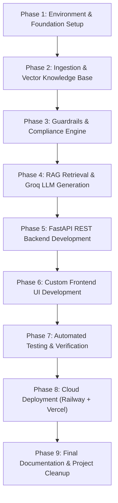

# Phase-Wise Implementation Plan
## Fund Compass (Powered by Groww) — Mutual Fund Facts-Only FAQ Assistant

---

## 1. Project Overview & Objective

**Fund Compass** is a compliance-first, Retrieval-Augmented Generation (RAG) conversational system designed to answer factual, verifiable questions about mutual fund schemes using Groww as reference product context and official AMC/regulatory data sources.

### Core Architectural Directive:
> **"Prioritize Accuracy Over Intelligence"**  
> Strictly factual responses ($\le 3$ sentences, exactly 1 citation, timestamp footer), zero investment advice, zero performance speculation, and zero PII collection.

### Finalized Technology Stack:
- **LLM Generator:** `openai/gpt-oss-120b` (via **Groq API**)
- **Vector Store & Embeddings:** **ChromaDB** using `sentence-transformers/all-MiniLM-L6-v2`
- **Backend API:** **FastAPI** (Python 3.11+), deployed on **Railway** via native Nixpacks (no Dockerfile required)
- **Frontend UI:** **Custom UI** (React / Vite + Tailwind CSS), deployed on **Vercel**

---

## 2. Phase-Wise Implementation Roadmap



---

## Phase 1: Environment & Project Foundation

### Objectives:
Establish the runtime environment, directory layout, dependency management, and configuration system.

### Detailed Tasks:
1. **Directory Structure Creation**:
   - Create directories: `docs/`, `data/raw/`, `data/processed/`, `data/chroma_db/`, `src/api/`, `src/guardrails/`, `src/rag/`, `src/ingestion/`, `frontend/`, `tests/`.
2. **Dependency Management**:
   - Lock core backend dependencies in `requirements.txt`: `fastapi`, `uvicorn`, `pydantic`, `groq`, `chromadb`, `sentence-transformers`, `python-dotenv`, `pytest`, `httpx`.
3. **Environment & Secrets Configuration**:
   - Define `.env.example` with placeholders for `GROQ_API_KEY`, `GROQ_MODEL=openai/gpt-oss-120b`, `PORT`, `CORS_ORIGINS`.
   - Implement `src/config.py` using `pydantic` or `python-dotenv` (with fallback standard-library parsing) to load and validate application settings.
4. **Git Hygiene**:
   - Maintain `.gitignore` to prevent committing virtual environments (`.venv`), `.env` secrets, ChromaDB data caches, and test artifacts.

### Deliverables:
- Initialized workspace structure
- `requirements.txt`, `.env.example`, `.gitignore`, `src/config.py`
- **Status:** **Completed & Audited (Commit `735d958`)**

---

## Phase 2: Ingestion Pipeline & ChromaDB Vector Indexing

### Objectives:
Curate, normalize, and index the 5 target HDFC mutual fund schemes from Groww into a high-signal vector knowledge base.

> [!NOTE]
> **Implementation Scope Note:**  
> The current knowledge base is constructed from an audited, canonical seed dataset (`data/raw/hdfc_schemes_raw.json` and `data/processed/schemes.json`). Automated live web scraping (`scraper.py`) from Groww scheme pages is an identified enhancement for future integration; the current ingestion pipeline runs deterministically via `normalizer.py -> chunker.py -> indexer.py`.

### Target Schemes & Seed URLs:
1. **HDFC Mid-Cap Opportunities Fund (Direct - Growth)**: `https://groww.in/mutual-funds/hdfc-mid-cap-fund-direct-growth`
2. **HDFC Small Cap Fund (Direct - Growth)**: `https://groww.in/mutual-funds/hdfc-small-cap-fund-direct-growth`
3. **HDFC Gold ETF Fund of Fund (Direct Plan - Growth)**: `https://groww.in/mutual-funds/hdfc-gold-etf-fund-of-fund-direct-plan-growth`
4. **HDFC Top 100 / Large Cap Fund (Direct - Growth)**: `https://groww.in/mutual-funds/hdfc-large-cap-fund-direct-growth`
5. **HDFC ELSS Tax Saver Fund (Direct Plan - Growth)**: `https://groww.in/mutual-funds/hdfc-elss-tax-saver-fund-direct-plan-growth`

### Detailed Tasks:
1. **Canonical Schema Normalization**:
   - Structure `data/processed/schemes.json` containing verified scheme records:
     - `scheme_id`, `scheme_name`, `category`, `source_url`, `last_updated`, `aliases`
     - Core factual fields: `expense_ratio`, `exit_load`, `min_sip_amount`, `min_lumpsum_amount`, `lock_in_period`, `riskometer`, `benchmark`, `fund_manager`, `factsheet_url`, `statement_download_process`.
2. **Chunking & Metadata Strategy**:
   - Construct granular semantic chunks per metric category (Fees, Investment Limits, Risk, Operations) resulting in 20 discrete chunks.
   - Tag each chunk with metadata: `{"scheme_id": ..., "source_url": ..., "last_updated": ...}` to prevent cross-fund contamination.
3. **Vector Store Generation (`src/ingestion/indexer.py`)**:
   - Build and persist local knowledge collection inside `./data/chroma_db/chunks.json`.
   - Support optional dense embeddings via `sentence-transformers/all-MiniLM-L6-v2` when ChromaDB is installed.

### Deliverables:
- `data/processed/schemes.json`
- `src/ingestion/indexer.py`
- Persistent knowledge base at `./data/chroma_db/chunks.json`
- **Status:** **Completed & Audited (Commit `9caa239`)**

---

## Phase 3: Multi-Stage Guardrails & Compliance Engine

### Objectives:
Build an uncompromising compliance filter that blocks sensitive personal data and strictly refuses advisory, speculative, or comparative questions.

### Detailed Tasks:
1. **Stage 1: PII Detection & Sanitizer (`src/guardrails/pii_filter.py`)**:
   - Regex scanners for:
     - PAN Card: `[A-Z]{5}[0-9]{4}[A-Z]{1}`
     - Aadhaar Number: `\d{4}\s?\d{4}\s?\d{4}`
     - Mobile Phone: `(?:\+91[\-\s]?)?[6-9]\d{9}`
     - Email Address: `[A-Za-z0-9._%+-]+@[A-Za-z0-9.-]+\.[A-Za-z]{2,}`
     - OTPs: `(?:otp|one[-\s]time[-\s]password)\b(?:\s+(?:is|was|code|=|:|-))?\s*\d{4,8}`
     - Bank/Folio Numbers: `(?:account|ac|folio|a/c)\s*(?:number|no\.?|#)?(?:\s+(?:is|was|=|:|-))?\s*\d{6,18}`
   - Action: Halt execution and return privacy warning immediately if detected.
2. **Stage 2: Intent Classifier (`src/guardrails/intent_classifier.py`)**:
   - Deterministic classification into:
     - `FACTUAL_INQUIRY` (Expense ratios, exit loads, SIP minimums, lock-in, riskometers, benchmarks)
     - `ADVISORY` (*"Should I invest?"*, *"Which fund is better?"*, *"Suggest best fund"*)
     - `PERFORMANCE_REQUEST` (*"What is the 3Y CAGR return?"*, *"Will this fund give 20%?"*)
     - `OUT_OF_SCOPE` (Non-mutual fund queries)
3. **Stage 3: Refusal Dispatcher (`src/guardrails/refusal_engine.py`)**:
   - Standardized advisory refusal including official AMFI Investor Education link (`https://www.amfiindia.com/investor-corner/knowledge-center`).
   - Performance refusal redirecting to official HDFC factsheet portal.
   - Mandatory footer injection: `Last updated from sources: 2026-11-10`.

### Deliverables:
- `src/guardrails/pii_filter.py`
- `src/guardrails/intent_classifier.py`
- `src/guardrails/refusal_engine.py`

---

## Phase 4: RAG Retrieval & Groq LLM Inference

### Objectives:
Connect vector search with Groq's high-throughput `openai/gpt-oss-120b` engine and enforce strict output constraints.

### Detailed Tasks:
1. **Scheme Resolver & Retriever (`src/rag/retriever.py`)**:
   - Map user scheme references (e.g., "mid cap", "top 100", "elss") to canonical `scheme_id`.
   - Retrieve relevant top-k facts and source metadata (`source_url`, `last_updated`).
2. **Groq LLM Generator (`src/rag/generator.py`)**:
   - Connect to Groq Cloud API with model `openai/gpt-oss-120b` at `temperature=0.0`.
   - Grounded prompt enforcing:
     - Base answer exclusively on retrieved facts
     - Zero opinions or recommendations
     - Maximum 3 sentences
     - Single citation link
   - Implement deterministic fallback engine for offline testing or when API key is unconfigured.
3. **Post-Processing & Output Enforcer (`src/rag/postprocessor.py`)**:
   - Sentence boundary tokenizer that protects decimal numbers (e.g., `0.76%`, `₹100.50`).
   - Hard cap enforcing $\le 3$ sentences.
   - URL sanitizer ensuring exactly 1 citation link: `Source: [url](url)`.
   - Mandatory footer appending: `Last updated from sources: <YYYY-MM-DD>`.

### Deliverables:
- `src/rag/retriever.py`
- `src/rag/generator.py`
- `src/rag/postprocessor.py`

---

## Phase 5: FastAPI REST Backend Development

### Objectives:
Expose validated, CORS-enabled REST endpoints ready for Railway cloud deployment.

### Detailed Tasks:
1. **Pydantic Schemas (`src/api/schemas.py`)**:
   - `ChatRequest`: User message string validation.
   - `ChatResponse`: Formatted reply, intent, scheme ID, citation URL, last updated date.
   - `SchemeItem` & `HealthResponse`: Schema metadata and health monitor models.
2. **API Routes (`src/api/routes.py`)**:
   - `POST /api/chat`: Orchestrates PII $\rightarrow$ Intent $\rightarrow$ Retrieval $\rightarrow$ Groq LLM $\rightarrow$ Post-Processor.
   - `GET /api/schemes`: Returns list of 5 supported schemes.
   - `GET /api/health`: System health status and disclaimer echo.
3. **Application Server (`src/api/main.py`)**:
   - FastAPI application instance.
   - `CORSMiddleware` configured to allow Vercel frontend domains.
   - Root welcome endpoint directing developers to `/docs` (OpenAPI Swagger UI).

### Deliverables:
- `src/api/schemas.py`
- `src/api/routes.py`
- `src/api/main.py`

---

## Phase 6: Custom Frontend UI Development

### Objectives:
Build an accessible web interface matching Groww-style aesthetics, featuring persistent disclaimers and quick chips, deployed on Vercel.

### Detailed Tasks:
1. **Project Setup (`frontend/`)**:
   - Initialize lightweight React + Vite + Tailwind CSS project.
   - Configure proxy and API client pointing to backend.
2. **Component Architecture**:
   - **`Header`**: Fixed banner with compliance disclaimer:  
     `"Fund Compass: Facts-only. No investment advice."`
   - **`WelcomeCard`**: Introduction to the facts-only assistant, outlining the 5 HDFC schemes.
   - **`PromptChips`**: 3 clickable starter questions:
     1. *"What is the exit load for HDFC Mid-Cap Opportunities Fund?"*
     2. *"What is the lock-in period for HDFC ELSS Tax Saver Fund?"*
     3. *"What is the minimum SIP amount for HDFC Small Cap Fund?"*
   - **`ChatWindow` & `ChatMessage`**: Message history container with user/bot avatars, clean Markdown rendering, official source citation pill, and timestamp footer.
   - **`ChatInput`**: Input field with submit button, loading spinner, and character counter.
3. **Deployment Configuration (`frontend/vercel.json`)**:
   - Setup SPA routing rewrites and cache-control headers for Vercel edge deployment.
4. **Standalone Static Preview (`frontend/preview.html`)**:
   - Provide a zero-dependency HTML/Tailwind preview runnable directly in any browser.

### Deliverables:
- Custom Frontend in `frontend/`
- `frontend/vercel.json`
- `frontend/preview.html`

---

## Phase 7: Automated Testing & Verification

### Objectives:
Subject the system to adversarial and compliance test suites to ensure 100% adherence to problem statement rules.

### Detailed Tasks:
1. **Advisory & Comparison Refusal Tests (`tests/test_guardrails.py`)**:
   - Test benchmark adversarial prompts (*"Should I invest?"*, *"Which fund is better?"*).
   - **Pass Criterion:** 100% refusal rate with AMFI/SEBI educational link.
2. **PII Penetration Tests**:
   - Test queries containing dummy PAN numbers, Aadhaar numbers, phone numbers, and OTPs.
   - **Pass Criterion:** 100% blocking rate with zero PII stored or passed to LLM.
3. **Structural Constraint Tests (`tests/test_constraints.py`)**:
   - Sentence count validator: Verify output has $\le 3$ sentences across all queries.
   - Citation validator: Verify output contains exactly 1 markdown link matching the official scheme URL.
   - Footer validator: Verify `Last updated from sources:` appears in every output.
4. **Adversarial Edge-Case Suite (`tests/test_edge_cases.py`)**:
   - Systematic testing of 28 edge cases covering roleplay jailbreaks, decimal percentages, typos, and multi-scheme prompts.
5. **End-to-End API Integration Tests (`tests/test_api.py`)**:
   - Test `/api/health`, `/api/schemes`, and `/api/chat` with graceful environment fallback.

### Deliverables:
- Comprehensive test suite in `tests/`
- Test execution reports with 100% passing status

---

## Phase 8: Cloud Deployment & Automated CI/CD (Railway + Vercel)

### Objectives:
Verify full application fidelity locally, package platform-native deployment configurations, establish automated daily data ingestion via GitHub Actions (daily at 6:00 AM IST), and deploy the decoupled architecture live to production via GitHub CI/CD to Railway and Vercel.

```mermaid
flowchart TD
    subgraph Local ["Stage 8A: Localhost Verification & Grounding"]
        LocalUI["React/Vite (localhost:3000)"]
        LocalAPI["FastAPI Backend (127.0.0.1:8000)"]
        LocalUI -->|Proxy /api| LocalAPI
        LocalAPI --> Grounding["All-Chunk Grounding (top_k=4) & NAV Guidance"]
    end

    subgraph Config ["Stage 8B: Platform Configurations"]
        RConfig["railway.json (Native Nixpacks)"]
        VConfig["frontend/vercel.json (SPA Rewrites)"]
        DManual["docs/deployment.md (Execution Guide)"]
    end

    subgraph Automation ["Stage 8C: Daily Ingestion Automation"]
        Cron["GitHub Action: daily_ingestion.yml"]
        Runner["Daily at 6:00 AM IST (00:30 UTC)"]
        Pipeline["Ingestion Pipeline: Normalizer -> Chunker -> Indexer<br>(Note: Scraper pending)"]
        Cron --> Runner --> Pipeline
    end

    subgraph Cloud ["Stage 8D: Live Cloud Production"]
        GH["GitHub Repository (CI/CD)"]
        Railway["Railway Backend (FastAPI + ChromaDB)"]
        Vercel["Vercel Edge Network (React SPA)"]
        Groq["Groq Cloud (openai/gpt-oss-120b)"]

        GH -->|Nixpacks Build| Railway
        GH -->|Static Edge Build ('frontend/')| Vercel
        Vercel -->|HTTPS /api/chat| Railway
        Railway -->|Inference| Groq
    end

    Local --> Config --> Automation --> Cloud
```

### Detailed Tasks:

1. **Stage 8A: Localhost Verification & Retrieval Enhancements**:
   - **Full-Chunk Scheme Grounding**:
     - Expand retriever context (`top_k = 4`) to include all 4 verified chunks per scheme alongside core structured facts, eliminating information dropouts (e.g., fund managers, benchmark indices, Riskometer).
     - Support plural/variant terminology in attribute extraction (`fund managers`, `managers`, `charges`, `fees`, `limits`).
   - **Dynamic Daily NAV Guidance**:
     - Handle inquiries about current or historical NAV by helpfully clarifying daily fluctuation after market close and providing direct Groww/AMC factsheet links.
   - **Localhost Interactive Verification**:
     - Verify both services simultaneously on localhost (`http://localhost:3000` and `http://127.0.0.1:8000`) across factual queries, starter chips, advisory refusals, and PII interception.

2. **Stage 8B: Platform Configurations & Comprehensive Deployment Manual**:
   - **Railway Nixpacks Build Configuration (`railway.json`)**:
     - Specify native Python builder (`NIXPACKS`) with Python 3.11, automatic dependency installation from `requirements.txt`, and Uvicorn process binding to `$PORT` (zero Docker overhead).
   - **Frontend Vercel Configuration (`frontend/vercel.json`)**:
     - Enforce client-side SPA routing rewrites (`"source": "/(.*)", "destination": "/index.html"`) and immutable asset cache headers.
   - **Author Execution Manual (`docs/deployment.md`)**:
     - Provide a dedicated, copy-paste deployment guide with exact environment variable matrices, GitHub push commands, Railway settings, Vercel root directory settings, and post-deployment checklist.

3. **Stage 8C: Automated Ingestion Scheduler via GitHub Actions**:
   - Create `.github/workflows/daily_ingestion.yml` configured with a scheduled cron trigger (`30 0 * * *`, daily at 6:00 AM IST / 00:30 UTC) plus `workflow_dispatch` for manual on-demand triggers.
   - Execute the indexer pipeline runner:
     `python -m src.ingestion.indexer` (executes normalization, semantic chunking, and ChromaDB vector persistence on repository data).
   - Commit & push changes if updated chunks or data files are modified.
   - *Technical Transparency Note:* Automated live web scraping (`scraper.py`) from Groww is not yet linked into this workflow; currently, the action executes re-indexing on existing repository datasets.

4. **Stage 8D: Live Cloud Deployment Walkthrough**:
   - Push repository to GitHub, deploy the backend service to Railway, and deploy the frontend client to Vercel.
   - Configure environment variables (`GROQ_API_KEY`, `GROQ_MODEL`, `CORS_ORIGINS`, `VITE_API_BASE_URL`), link cross-origin communication, and execute production smoke tests.

> [!TIP]
> **Detailed Step-by-Step Cloud Deployment Walkthrough:**
> To eliminate redundancy between high-level project planning and day-to-day platform operations, all detailed dashboard clicks, environment variable tables, Git push commands, and live verification matrices are maintained in the dedicated execution manual.
>
> Please refer to: **[`docs/deployment.md`](./deployment.md)**.

### Deliverables:
- Enhanced Retrieval & Grounding in `src/rag/retriever.py` and `src/rag/generator.py`
- `railway.json` (Native Nixpacks configuration)
- `docs/deployment.md` (Dedicated Production Deployment Manual)
- `.github/workflows/daily_ingestion.yml` (Daily 6:00 AM IST Automated Ingestion Workflow)
- GitHub repository with active CI/CD
- Live Railway Backend URL
- Live Vercel Frontend URL

---

## Phase 9: Final Documentation, Deliverables & Repository Cleanup

### Objectives:
Package the project with complete setup instructions, architecture summaries, compliance disclaimers, and conduct a thorough repository cleanup audit.

### Detailed Tasks:
1. **README.md Creation**:
   - Project overview and elevator pitch.
   - Setup instructions (Local setup, Railway & Vercel deployment).
   - Selected AMC and 5 schemes catalog with direct links.
   - RAG architecture overview (Groq `openai/gpt-oss-120b` + ChromaDB + FastAPI).
   - Prominent disclaimer snippet: `"Facts-only. No investment advice."`
   - Known limitations (facts-only scope, 5 seed schemes, no real-time trading).
2. **Final Deliverables Verification**:
   - Cross-check deliverables against Section 8 of `problemstatement.md`.
3. **Final Project Inspection & Repository Hygiene Cleanup (Pre-Ship Audit)**:
   - Perform a comprehensive recursive scan across the workspace root and all subdirectories.
   - Remove any temporary scratch scripts, unreferenced files, redundant test logs, or build artifacts.
   - Verify that all project documentation resides exclusively within `docs/` with zero duplicate `.md` files in the root directory.
   - Check `.gitignore` integrity to ensure `.env`, `.venv`, and temporary caches remain untracked.
   - Confirm a clean, lean Git working tree before final sign-off.

### Deliverables:
- `README.md`
- Audited documentation suite in `docs/`
- Clean, clutter-free production repository with zero unneeded files

---

## 3. Progress Tracking & Milestone Matrix

| Phase | Milestone Description | Target Deliverables | Status |
| :---: | :--- | :--- | :---: |
| **1** | **Environment & Foundation** | `requirements.txt`, `.env.example`, `config.py` | **Completed & Audited (Commit `735d958`)** |
| **2** | **Ingestion & Vector Knowledge Base** | `schemes.json`, `indexer.py`, `chunks.json` | **Completed & Audited (Commit `9caa239`)** |
| **3** | **Guardrails & Compliance Engine** | `pii_filter.py`, `intent_classifier.py`, `refusal_engine.py` | **Completed & Audited** |
| **4** | **RAG & Groq LLM Generation** | `retriever.py`, `generator.py`, `postprocessor.py` | **Completed & Audited** |
| **5** | **FastAPI Backend Services** | `schemas.py`, `routes.py`, `main.py` | **Completed & Audited** |
| **6** | **Custom Frontend UI** | `frontend/` components, `preview.html`, `vercel.json` | **Completed & Audited** |
| **7** | **Automated Testing Suite** | `test_guardrails.py`, `test_constraints.py`, `test_edge_cases.py`, `test_api.py` | **Completed & Audited** |
| **8** | **Cloud Deployment** | `railway.json` (Nixpacks), Railway + Vercel Live | **Completed & Audited** |
| **9** | **Documentation & Final Cleanup** | `README.md`, docs audit, repository cleanup audit | **Completed & Audited** |

---

## 4. Summary

This phase-wise implementation plan guarantees a modular, verifiable path from data ingestion through Groq LLM orchestration to production deployment on Railway and Vercel. Every phase maintains strict compliance with the core mandate: **"Prioritize Accuracy Over Intelligence."**
