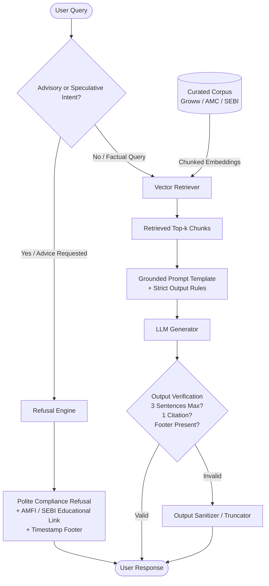

# Fund Compass (Powered by Groww) — Mutual Fund Facts-Only FAQ Assistant

> **Disclaimer:** Facts-only. No investment advice.

---

## 1. Executive Summary & Vision

**Fund Compass powered by Groww** is a specialized, compliance-first, Retrieval-Augmented Generation (RAG) assistant designed to answer factual and verifiable questions about mutual fund schemes. Using Groww as the reference product context alongside primary regulatory and Asset Management Company (AMC) sources (AMC websites, AMFI, SEBI), Fund Compass delivers concise, source-backed responses while strictly prohibiting any form of investment advice, return speculation, or subjective recommendation.

The guiding philosophy of Fund Compass is:
> **"Prioritize Accuracy Over Intelligence."**  
> In financial domains, providing a safe, verified, and restricted factual response is infinitely superior to generating fluent yet speculative or hallucinated guidance.

---

## 2. Problem Statement

### 2.1 The Challenge
Retail investors and support teams frequently encounter repetitive, objective questions regarding mutual funds—such as expense ratios, exit loads, lock-in periods, taxation rules, and benchmark indices. However:
1. **Proliferation of Unverified Advice:** Many conversational bots produce hallucinatory advice, return predictions, or subjective fund comparisons that violate financial regulatory compliance.
2. **Scattered Factual Data:** Key operational details (SIP minimums, riskometers, portfolio cut-offs, capital gains report processes) are dispersed across lengthy factsheets, Scheme Information Documents (SIDs), and web pages.
3. **Regulatory Non-Compliance:** Unlicensed automated tools that offer opinions or compare scheme superiority expose platforms to regulatory friction (SEBI guidelines on investment advice).

### 2.2 Project Objective
Design and implement a lightweight, robust **RAG-based FAQ assistant** that:
- Ingests and grounds knowledge strictly from verified, official mutual fund sources.
- Delivers objective, verified answers limited to facts.
- Adheres to rigid output constraints (maximum 3 sentences, 1 citation link, mandatory timestamped footer).
- Intelligently detects and refuses advisory or opinionated queries, redirecting users to official investor education materials.

---

## 3. Target Audience & Use Cases

| Target Group | Core Use Case | Key Value Received |
| :--- | :--- | :--- |
| **Retail Investors** | Checking scheme facts (e.g., minimum SIP, exit load, ELSS lock-in). | Rapid, zero-fluff, factual clarity with direct source links without unsolicited sales pitches. |
| **Customer Support Teams** | Handling repetitive mutual fund FAQ tickets. | Standardized, compliant answers reducing ticket resolution time and manual lookup effort. |
| **Content & Operations** | Verifying factsheet parameters against live scheme pages. | Single source of truth referencing official scheme documentation. |

---

## 4. Scope & Corpus Definition

### 4.1 Selected Asset Management Company (AMC)
- **Primary AMC:** **HDFC Mutual Fund** (HDFC Asset Management Company Limited)

### 4.2 Seed Corpus (Target Schemes)
The knowledge base is seeded with 5 core scheme categories hosted on Groww, mapped back to official factsheet/SID data:

| # | Scheme Name | Category | Reference URL |
| :-: | :--- | :--- | :--- |
| 1 | **HDFC Mid-Cap Opportunities Fund** | Equity: Mid Cap | [Groww Scheme Page](https://groww.in/mutual-funds/hdfc-mid-cap-fund-direct-growth) |
| 2 | **HDFC Small Cap Fund** | Equity: Small Cap | [Groww Scheme Page](https://groww.in/mutual-funds/hdfc-small-cap-fund-direct-growth) |
| 3 | **HDFC Gold ETF Fund of Fund** | Other: Commodities / Gold FoF | [Groww Scheme Page](https://groww.in/mutual-funds/hdfc-gold-etf-fund-of-fund-direct-plan-growth) |
| 4 | **HDFC Top 100 / Large Cap Fund** | Equity: Large Cap | [Groww Scheme Page](https://groww.in/mutual-funds/hdfc-large-cap-fund-direct-growth) |
| 5 | **HDFC ELSS Tax Saver Fund** | Equity: ELSS (Tax Saving) | [Groww Scheme Page](https://groww.in/mutual-funds/hdfc-elss-tax-saver-fund-direct-plan-growth) |

### 4.3 Authorized vs. Disallowed Sources

```
├── AUTHORIZED OFFICIAL SOURCES
│   ├── Official AMC Portals & Documents (HDFC MF Factsheets, SIDs, KIMs)
│   ├── Groww Scheme Fact Pages (Curated Reference Context)
│   ├── AMFI India Portal (Association of Mutual Funds in India)
│   └── SEBI Official Portal & Regulatory Circulars
│
└── DISALLOWED SOURCES (STRICT PROHIBITION)
    ├── Third-party investment blogs & forums
    ├── Unverified aggregator websites
    ├── Social media & opinion commentary
    └── Promotional marketing materials
```

---

## 5. Functional Requirements & System Capabilities

### 5.1 Permissible Factual Queries
The assistant answers objective, verifiable questions including:
- **Cost & Fees:** Current expense ratio (Direct Plan), entry/exit load percentages, and holding periods.
- **Investment Limits:** Minimum SIP amount, minimum lumpsum investment, and subsequent installment requirements.
- **Statutory Rules:** Lock-in duration for ELSS (Section 80C), tax treatment reference docs.
- **Risk & Profile:** SEBI Riskometer classification (e.g., *Very High*, *Moderate*) and benchmark index (e.g., NIFTY Midcap 150 TRI).
- **Account Operations:** Official procedure for downloading account statements, capital gains reports, and consolidated account statements (CAS).

### 5.2 Strict Response Formatting Constraints
Every factual answer generated by Fund Compass **MUST** satisfy three mandatory structural rules:

```
┌────────────────────────────────────────────────────────────────────────┐
│ Response Length: Maximum of 3 sentences (concise and factual).        │
│ Citation Link:   Exactly one (1) verifiable official URL.              │
│ Footer Format:   "Last updated from sources: <YYYY-MM-DD>"             │
└────────────────────────────────────────────────────────────────────────┘
```

#### Example Formatted Response:
> The HDFC Mid-Cap Opportunities Fund (Direct - Growth) currently has an expense ratio of 0.76% and applies a 1% exit load if redeemed within one year of allotment. The minimum initial SIP investment amount for this scheme is ₹100.
> 
> **Source:** [HDFC Mid-Cap Opportunities Fund - Groww](https://groww.in/mutual-funds/hdfc-mid-cap-fund-direct-growth)  
> *Last updated from sources: 2026-11-10*

---

### 5.3 Refusal Handling & Guardrails (Advisory & Speculative Queries)
The assistant must detect and strictly refuse any advisory, speculative, or comparative queries.

#### Prohibited Query Types:
- Advice: *"Should I invest in HDFC Small Cap Fund right now?"*
- Comparison / Preference: *"Which fund is better: HDFC Mid-Cap or HDFC Small Cap?"*
- Return Speculation: *"Will this fund give 20% returns next year?"*
- Recommendation: *"Suggest the best fund for a retired investor."*

#### Refusal Protocol:
When a prohibited query is identified, the assistant must:
1. **Politely Refuse:** State clearly that Fund Compass is a facts-only assistant and cannot provide financial advice, opinions, or performance predictions.
2. **Reinforce Compliance:** Remind the user of the *"Facts-only. No investment advice."* policy.
3. **Provide Educational Resource:** Include an official link to an educational portal (e.g., AMFI Investor Education or SEBI Investor Portal).
4. **Factsheet Redirection:** If asked for returns or performance comparisons, direct the user strictly to the official scheme factsheet without generating comparative commentary.

#### Example Refusal Response:
> I cannot provide investment advice, fund recommendations, or subjective comparisons. Fund Compass is strictly a facts-only assistant designed to provide verified scheme information. For guidance on financial planning and understanding mutual fund risks, please visit the official AMFI Investor Education portal: [AMFI Mutual Fund Sahi Hai](https://www.amfiindia.com/investor-corner/knowledge-center).
> 
> *Last updated from sources: 2026-11-10*

---

### 5.4 Minimal User Interface Requirements
The user interface should remain clean, accessible, and distraction-free:
1. **Header & Disclaimer:** Prominently visible banner stating:  
   `"Fund Compass: Facts-only. No investment advice."`
2. **Welcome Message:** A concise greeting outlining the purpose and capabilities of the assistant.
3. **Starter Prompt Chips (3 Examples):**
   - *"What is the exit load for HDFC Mid-Cap Opportunities Fund?"*
   - *"What is the lock-in period for HDFC ELSS Tax Saver Fund?"*
   - *"What is the minimum SIP amount for HDFC Small Cap Fund?"*
4. **Chat Window & Citation Renderer:** Clean Markdown rendering with clickable citation links and metadata footers.

---

## 6. Architecture & System Flow



---

## 7. System Constraints & Regulatory Guardrails

### 7.1 Data & Source Integrity
- Only verified, official sources (AMC official pages, AMFI, SEBI, and Groww official scheme pages) may be ingested.
- Zero reliance on third-party aggregators, forums, or blog posts.

### 7.2 Privacy & Security (Zero-PII Policy)
Fund Compass **never** collects, stores, logs, or processes:
- Permanent Account Number (PAN) or Aadhaar numbers
- Demat / Mutual Fund Folio or Bank Account numbers
- One-Time Passwords (OTPs) or PINs
- User Contact Details (Email addresses, phone numbers)

### 7.3 Content & Compliance Boundaries
- **No Advisory Bias:** Absolute restriction on "buy", "sell", "hold", "outperform", or "best" labels.
- **No Performance Guarantees:** Past returns must never be presented as indicators or forecasts of future results.
- **Link-Only Factsheets:** Performance queries must be satisfied by pointing to the official factsheet URL rather than generating unverified return summaries.

---

## 8. Expected Deliverables

1. **`problemstatement.md` / Documentation:**
   - Complete architectural overview, constraints, scope, and operational boundaries.
2. **README Document:**
   - Step-by-step setup and local execution instructions.
   - Selected AMC and schemes catalog.
   - RAG pipeline design, vector store setup, and model configuration.
   - Known limitations and future enhancements.
3. **Core RAG Pipeline & Ingestion Scripts:**
   - Scraping/Ingestion pipeline for the 5 selected scheme pages.
   - Vector database indexing and semantic retrieval module.
   - Guardrail and intent classification layer (Advisory vs. Factual).
4. **Chatbot Web Interface:**
   - Clean, lightweight UI (Streamlit, Gradio, or FastAPI + React).
   - Welcome message, 3 starter chips, and persistent compliance disclaimer.
5. **Standardized Disclaimer Snippet:**
   - `"Facts-only. No investment advice."` embedded across all UI and response outputs.

---

## 9. Success Criteria & Evaluation Metrics

| Metric | Target | Evaluation Method |
| :--- | :---: | :--- |
| **Retrieval Accuracy** | $\ge 98\%$ | Verified against official scheme documentation and factsheets. |
| **Advisory Refusal Rate** | $100\%$ | Rigorous testing against benchmark adversarial advisory prompts. |
| **Response Brevity** | $100\%$ | Automated check enforcing $\le 3$ sentences per factual answer. |
| **Citation Compliance** | $100\%$ | Every answer must contain exactly 1 verified, working source link. |
| **Auditability** | $100\%$ | Mandatory timestamp footer `"Last updated from sources: ..."` present on all outputs. |
| **Zero PII Leakage** | $0$ incidents | Inbound prompt filtering and sanitization. |

---

## 10. Summary

Fund Compass bridges the gap between complex mutual fund documentation and investor inquiries by delivering a **trustworthy, compliant, and facts-only** conversational interface. By enforcing strict RAG grounding, structural output limits, and robust refusal guardrails, the assistant upholds absolute regulatory compliance and transparency while keeping retail investors informed.

